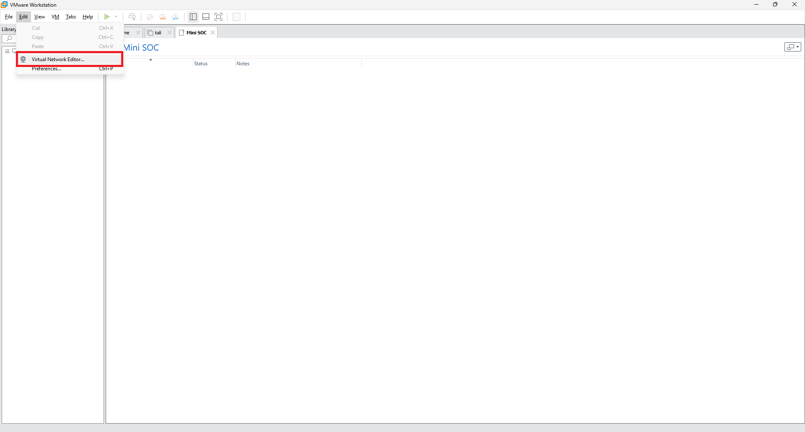
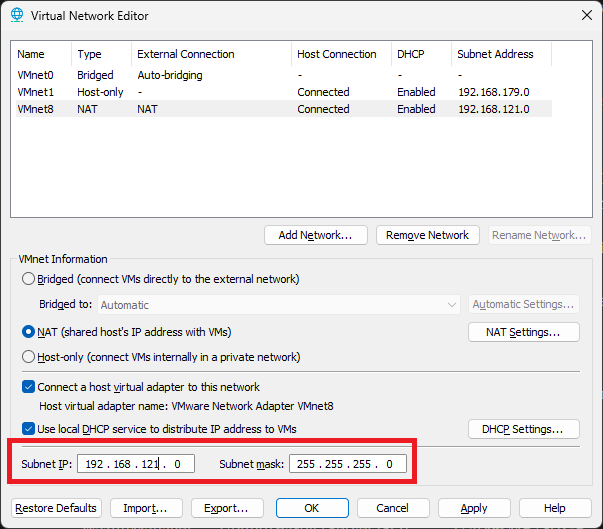
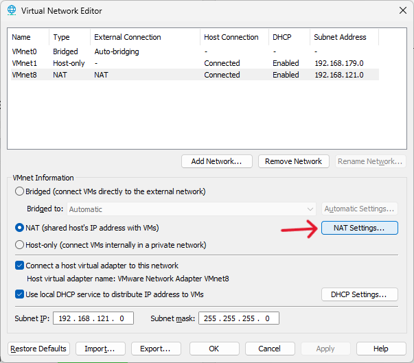
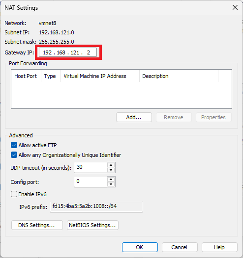

# Host Setup
### 2026-11-04 | Jeffar

1. Go to **VMware Workstation** and open **Virtual Network Editor**.

2. Change VMNet8’s **Subnet IP** to `192.168.121.0` and **Subnet mask** to `255.255.255.0`.

3. Click apply and go to NAT Settings and note the **default gateway**
which is `192.168.121.2`.

