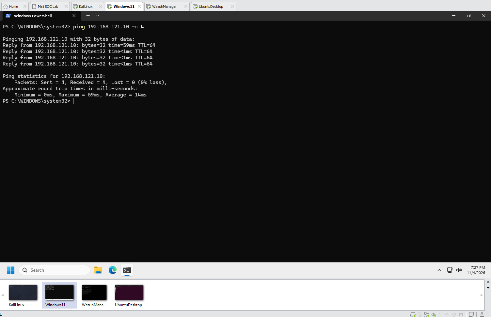
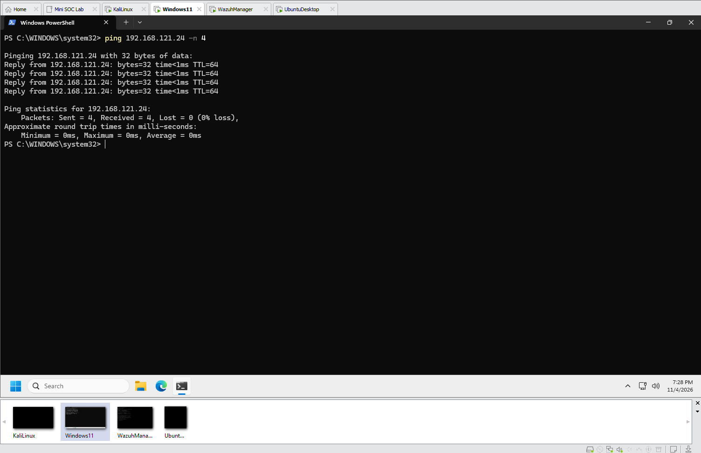
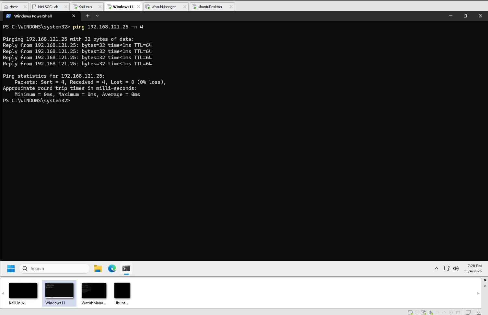
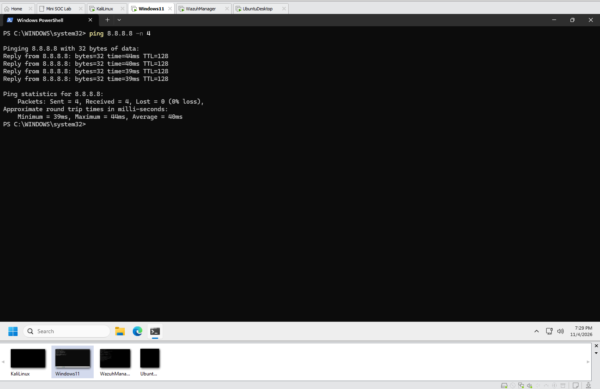
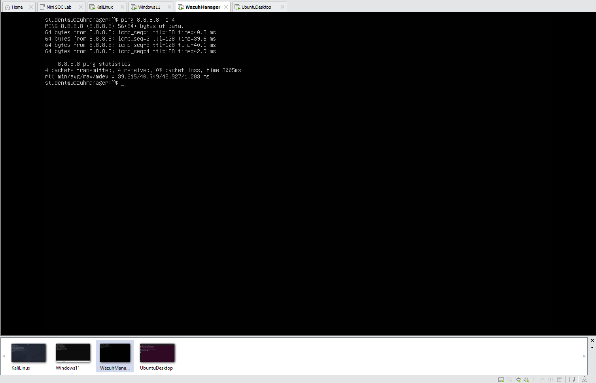
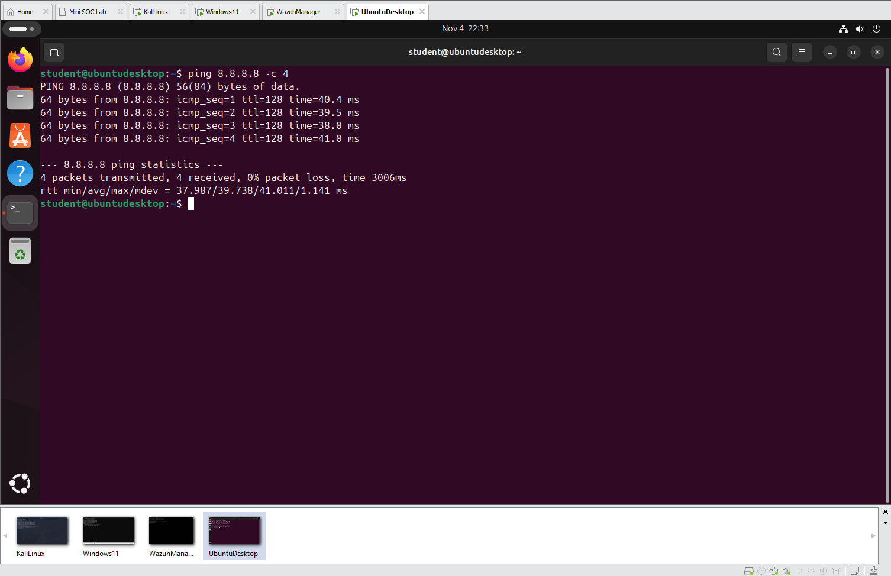
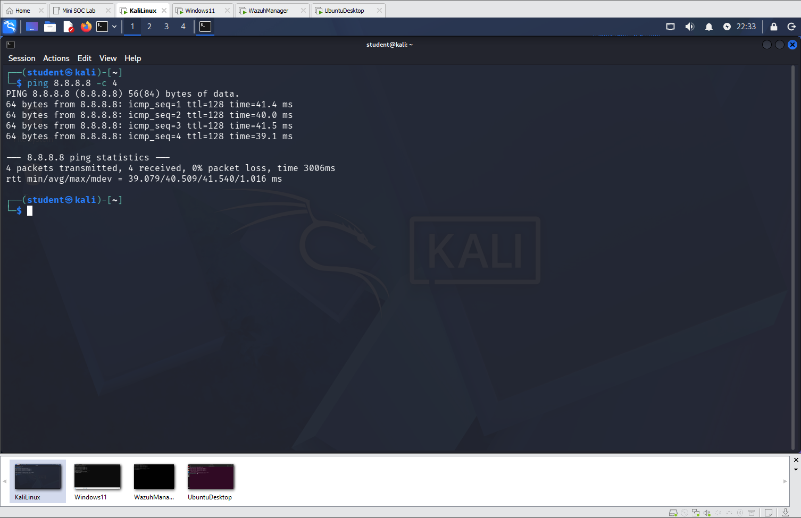

# Network and IP Configuration
### 2026-11-04 | Jeffar

1. On WazuhManager, edit the network configuration file (**netplan**).

```bash
sudo nano /etc/netplan/50-cloud-init.yaml
```

```yaml
network:

version: 2

ethernets:

ens33:

dhcp4: false

addresses: \[192.168.121.10/24\]

routes:

\- to: default

via: 192.168.121.2

nameservers:

addresses: \[8.8.8.8\]
```

Apply changes and save.

2. Restrict permissions to **600** to prevent other local users from
reading or modifying the file. Then, apply the network configuration.

```bash
sudo chmod 600 /etc/netplan/50-cloud-init.yaml && sudo netplan apply
```

3. Edit KaliLinux’s IPv4 settings.

```bash
nmcli con mod "Wired connection 1" ipv4.method manual ipv4.addresses
192.168.121.25/24 ipv4.gateway 192.168.121.2 ipv4.dns 8.8.8.8

nmcli con up "Wired connection 1"
```

4. Edit UbuntuDesktop’s IPv4 settings.

```bash
nmcli con mod "netplan-ens33" ipv4.method manual ipv4.addresses
192.168.121.24/24 ipv4.gateway 192.168.121.2 ipv4.dns 8.8.8.8

nmcli con up "netplan-ens33"
```

5. Edit Windows11’s IPv4 settings.

```bash
New-NetIPAddress -InterfaceAlias "Ethernet0" -IPAddress 192.168.121.11
-PrefixLength 24 -DefaultGateway 192.168.121.2

Set-DnsClientServerAddress -InterfaceAlias "Ethernet0" -ServerAddresses
8.8.8.8
```

6. Add a firewall rule for Windows11 to allow inbound ping so that it
can be pinged by other VMs.

```bash
New-NetFirewallRule -DisplayName "Allow ICMPv4-In" -Protocol ICMPv4
-IcmpType 8 -Action Allow
```

7. On Windows11, ping 192.168.121.10 to verify connectivity to
WazuhManager.



8. On Windows11, ping 192.168.121.24 to verify connectivity to
UbuntuDesktop.



9. On Windows11, ping 192.168.121.25 to verify connectivity to
KaliLinux.



10. On Windows11, ping 8.8.8.8 to verify connectivity to the internet.



11. On WazuhManager, ping 8.8.8.8 to verify connectivity to the
internet.



12. On UbuntuDesktop, ping 8.8.8.8 to verify connectivity to the
internet.



13. On KaliLinux, ping 8.8.8.8 to verify connectivity to the internet.



## Table 1 - VM Summary

| **VM Name** | **Role** | **IP** | **Host Name** | **Ping Successful (Y/N)** |
|----|----|----|----|----|
|  |  |  |  |  |
| Windows11 | Sysmon + Wazuh Agent + FIM (endpoint) | 192.168.121.11 | windows11 | Y |
| WazuhManager | Ubuntu Server - Wazuh Manager + Dashboard | 192.168.121.10 | wazuhmanager | Y |
| UbuntuDesktop | Suricata IDS + Wazuh Agent + FIM (endpoint) | 192.168.121.24 | ubuntudesktop | Y |
| KaliLinux | Attack simulation host | 192.168.121.25 | kalilinux | Y |

## Conclusion

All connectivity tests are successful and every VM can
connect to the internet.