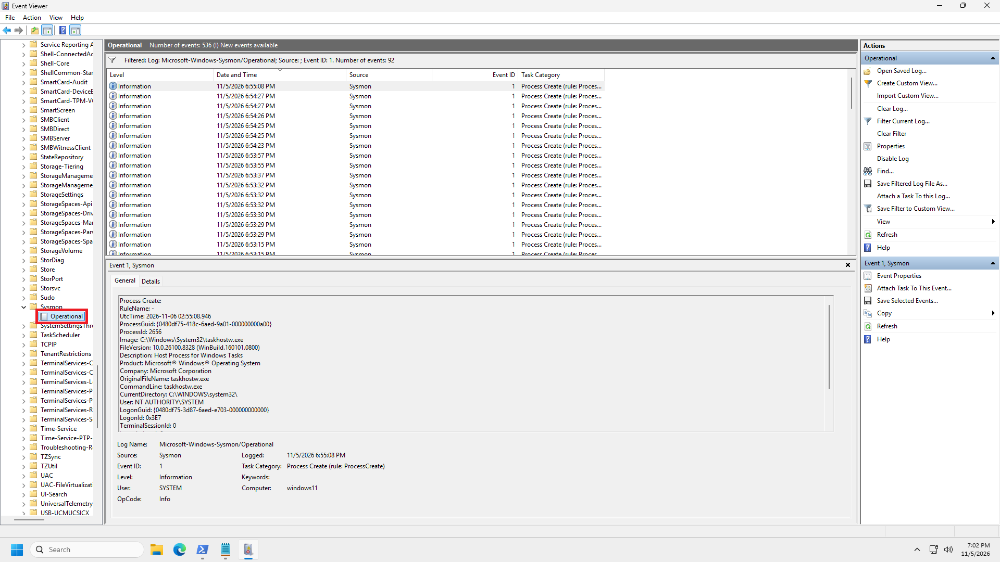
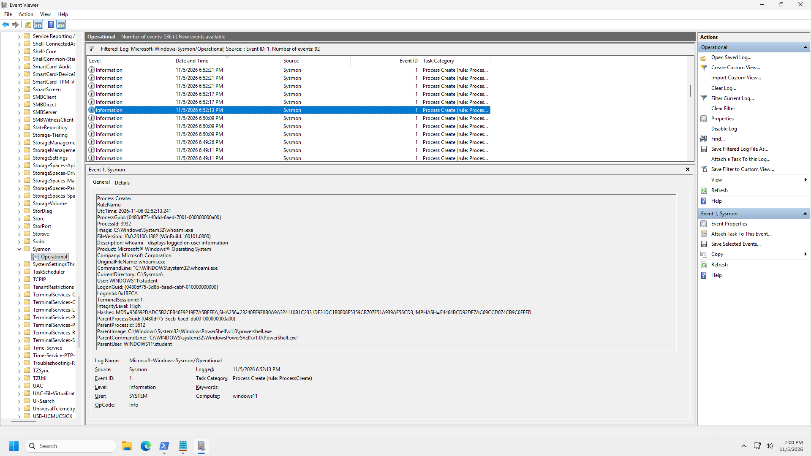
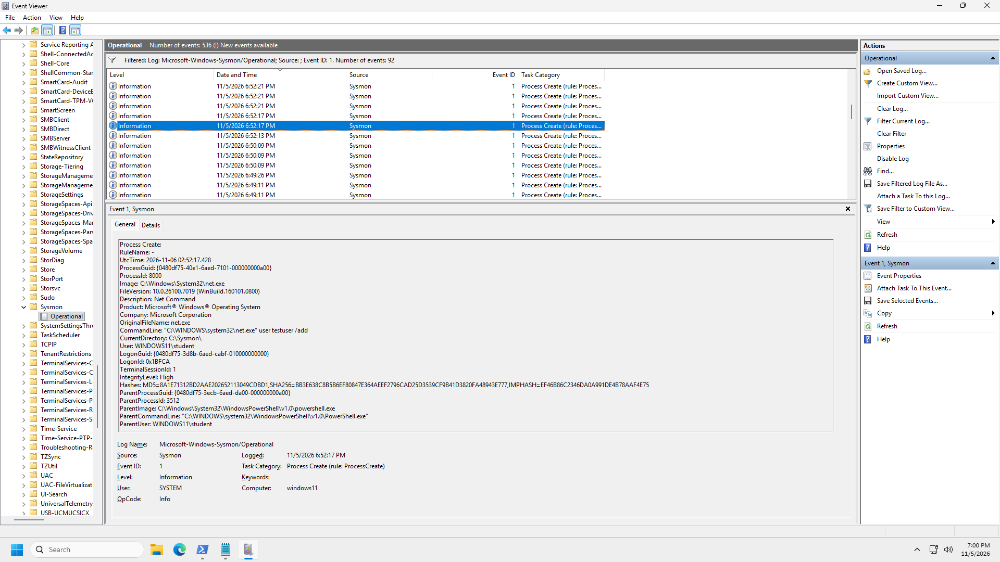
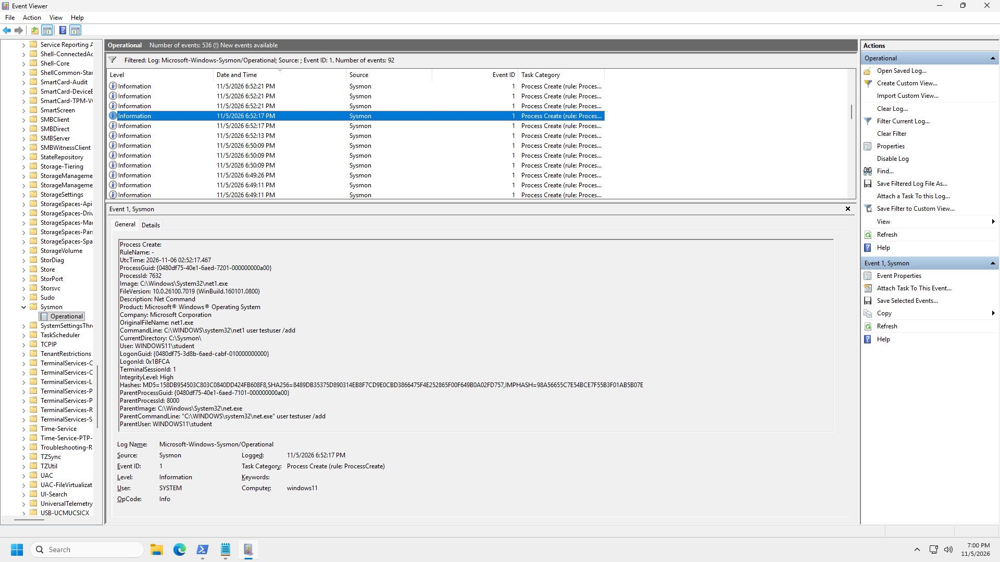
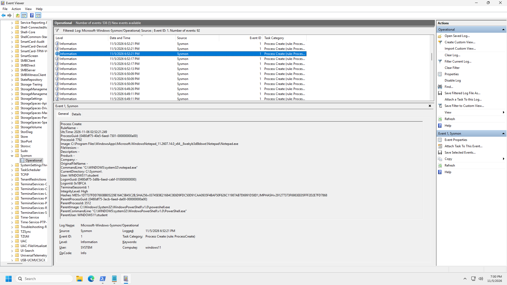

# Sysmon
### 2026-11-05 | Jeffar

1. Make Sysmon directory to work on.

```powershell
PS C:\WINDOWS\system32\> mkdir C:\Sysmon; cd C:\Sysmon
```

2. Download Sysmon from Microsoft.

```powershell
PS C:\WINDOWS\system32\> Invoke-WebRequest
https://download.sysinternals.com/files/Sysmon.zip -OutFile Sysmon.zip
```

3. Download the SwiftOnSecurity config, this tells Sysmon what to log.

```powershell
PS C:\WINDOWS\system32\> Invoke-WebRequest
https://raw.githubusercontent.com/SwiftOnSecurity/sysmon-config/master/sysmonconfig-export.xml
-OutFile sysmonconfig-export.xml
```

4. Unzip Sysmon into the current folder.

```powershell
PS C:\WINDOWS\system32\> Expand-Archive Sysmon.zip -DestinationPath .
-Force
```

5. Install Sysmon as a service using the SwiftOnSecurity config. (This
requires elevated privileges)

```powershell
PS C:\WINDOWS\system32\> .\Sysmon64.exe -accepteula -i
sysmonconfig-export.xml
```

output:

```powershell
System Monitor v15.22 - System activity monitor

By Mark Russinovich and Thomas Garnier

Copyright (C) 2014-2026 Microsoft Corporation

Using libxml2. libxml2 is Copyright (C) 1998-2012 Daniel Veillard. All
Rights Reserved.

Sysinternals - www.sysinternals.com

Loading configuration file with schema version 4.50

Sysmon schema version: 4.91

Configuration file validated.

Sysmon64 installed.

SysmonDrv installed.

Starting SysmonDrv.

SysmonDrv started.

Starting Sysmon64..

Sysmon64 started.
```

6. Check that the Sysmon service is running.

```powershell
PS C:\WINDOWS\system32\> Get-Service Sysmon64
```

output:

```powershell
Status Name DisplayName ------ ---- ----------- Running Sysmon64
Sysmon64
```

7. Run the three test events.

```powershell
PS C:\WINDOWS\system32\> whoami

PS C:\WINDOWS\system32\> net user testuser /add

PS C:\WINDOWS\system32\> notepad.exe
```

8. Open Event Viewer (eventvwr.msc). Go to Applications and Services
Logs, then to Microsoft, then Windows, then Sysmon, then Operational.



9. Find the Event ID 1 entry for whoami.



10. Find the Event ID 1 entries for net user, net.exe and its child
net1.exe.





11. Find the Event ID 1 entry for notepad.



## Table

<table>
<colgroup>
<col style="width: 12%" />
<col style="width: 9%" />
<col style="width: 29%" />
<col style="width: 12%" />
<col style="width: 15%" />
<col style="width: 8%" />
<col style="width: 11%" />
</colgroup>
<thead>
<tr>
<th><p><strong>Test Activity</strong></p></th>
<th><p><strong>Event ID</strong></p></th>
<th><p><strong>Image</strong></p></th>
<th><p><strong>Process Name</strong></p></th>
<th><p><strong>Observed CommandLine</strong></p></th>
<th><p><strong>User</strong></p></th>
<th><p><strong>Log Source</strong></p></th>
</tr>
</thead>
<tbody>
<tr>
<td><p>Run <strong>whoami</strong></p></td>
<td><p>1</p></td>
<td><p>C:\Windows\System32\whoami.exe</p></td>
<td><p>whoami.exe</p></td>
<td><p>"C:\WINDOWS\system32\whoami.exe"</p></td>
<td><p>WINDOWS11\student</p></td>
<td><p>Sysmon</p></td>
</tr>
<tr>
<td><p>Run <strong>net user testuser /add</strong></p></td>
<td><p>1</p></td>
<td><p>C:\Windows\System32\net.exe</p>
<p>C:\Windows\System32\net1.exe</p></td>
<td><p>net.exe</p>
<p>net1.exe</p></td>
<td><p>"C:\WINDOWS\system32\net.exe" user testuser /add</p>
<p>C:\WINDOWS\system32\net1 user testuser /add</p></td>
<td><p>WINDOWS11\student</p></td>
<td><p>Sysmon</p></td>
</tr>
<tr>
<td><p>Launch <strong>notepad.exe</strong></p></td>
<td><p>1</p></td>
<td><p>C:\WINDOWS\system32\notepad.exe</p></td>
<td><p>notepad.exe</p></td>
<td><p>"C:\WINDOWS\system32\notepad.exe"</p></td>
<td><p>WINDOWS11\student</p></td>
<td><p>Sysmon</p></td>
</tr>
</tbody>
</table>

## Conclusion

**Sysmon** was installed on the Windows 11 endpoint with the
**SwiftOnSecurity** configuration and confirmed running as a service.
Running whoami, net user testuser /add and notepad.exe from an elevated
PowerShell session produced matching Event ID 1 (Process Create) entries
in the Sysmon Operational log. Each event recorded the process image,
command line, user and parent process, which let each action be traced
back to the PowerShell session that launched it. The net user command
also generated a child net1.exe event, showing how a single command can
produce more than one process record. This validation shows that
endpoint telemetry gives detail that network monitoring cannot, such as
which user ran what and from which parent process, so it is a strong
input for host-based intrusion detection.
