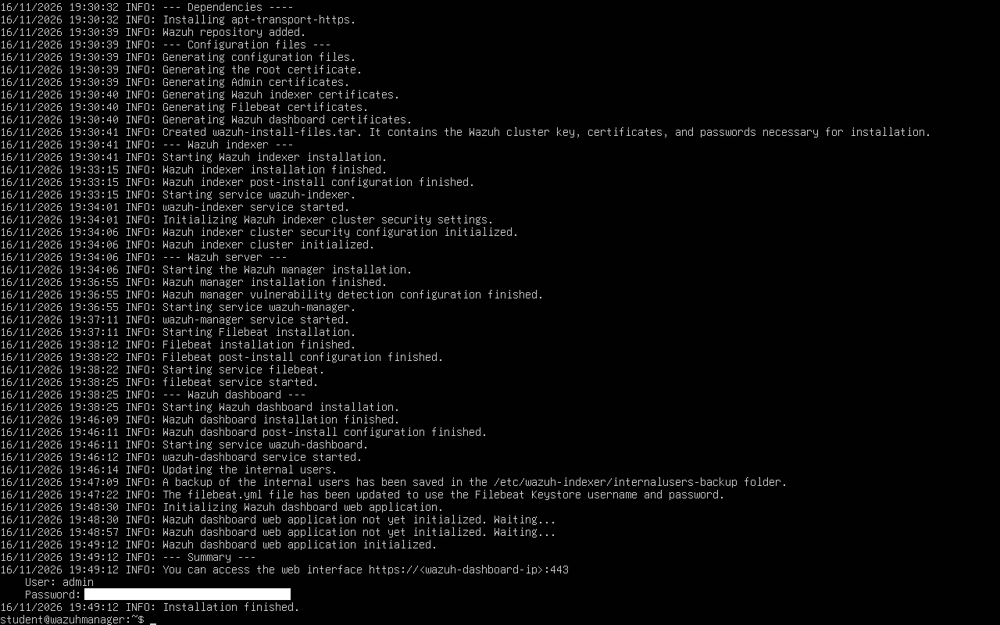
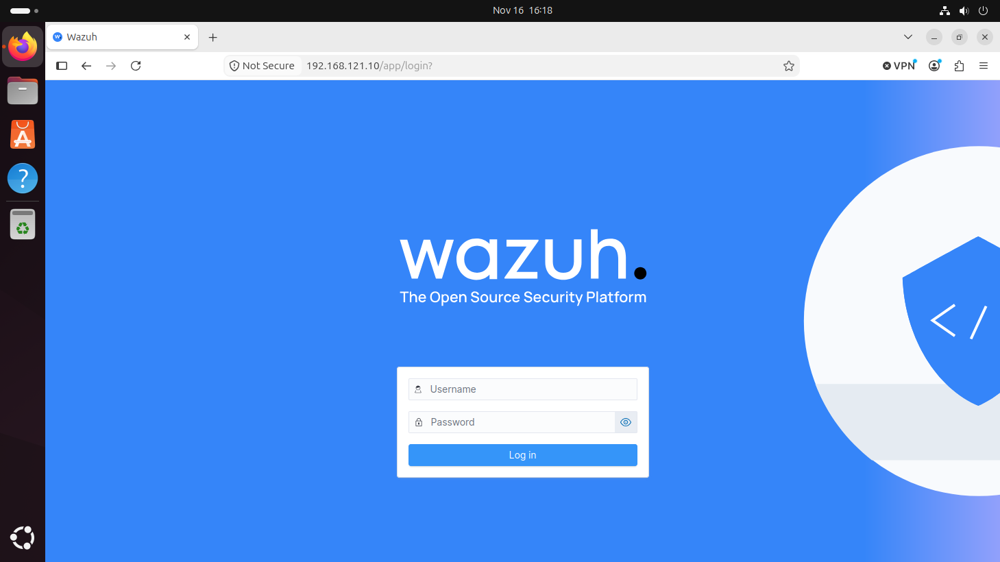
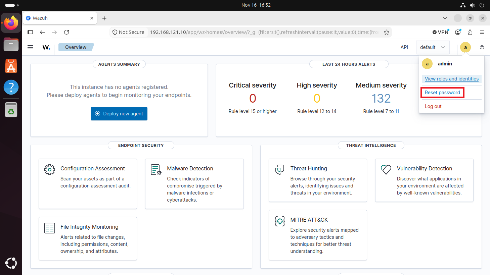

# Wazuh Installation
### 2026-11-16 | Jeffar

1. Make sure that the ubuntu server is up to date.

```bash
student@wazuhmanager:~\$ sudo apt update && sudo apt upgrade -y
```

2. Reboot if upgrade requires.

```bash
student@wazuhmanager:~\$ sudo reboot
```

3. Install Wazuh using the [official Wazuh installation
guide](https://documentation.wazuh.com/current/quickstart.html).

```bash
student@wazuhmanager:~\$ curl -sO
https://packages.wazuh.com/4.14/wazuh-install.sh && sudo bash
./wazuh-install.sh -a
```

4. Confirm Wazuh All-In-One successfully installed on the Ubuntu
server.


5. On KaliLinux, UbuntuDesktop, or Windows11, go to
http://192.168.121.10.



6. Login using default credentials discovered right after the
installation.


7. If successfully logged in, reset your password if necessary.



alternatively, on WazuhManager:

```bash
student@wazuhmanager:~\$ sudo bash
/usr/share/wazuh-indexer/plugins/opensearch-security/tools/wazuh-passwords-tool.sh
-u admin -p ‘PASSWORD_HERE’
```

## Conclusion

**Wazuh** All-in-One was successfully installed on the
Ubuntu server and accessed through its web interface. The initial login
was verified, and the admin password was reset to secure the
installation.
