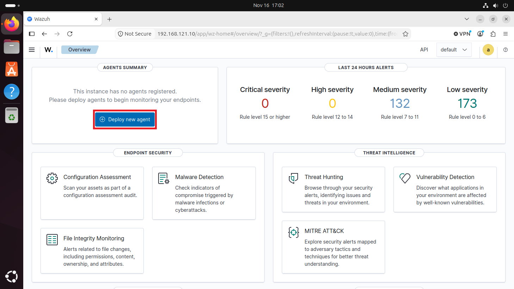
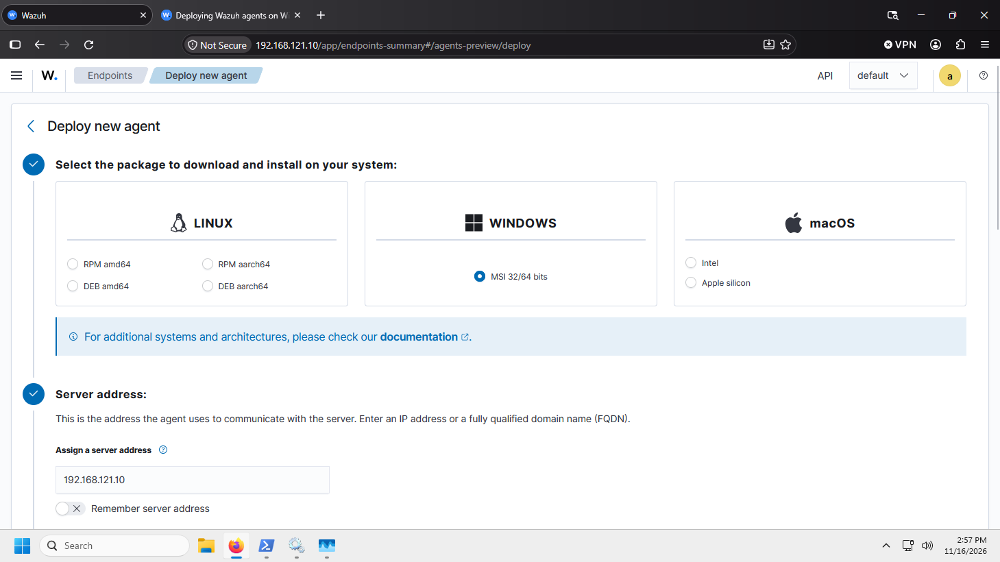
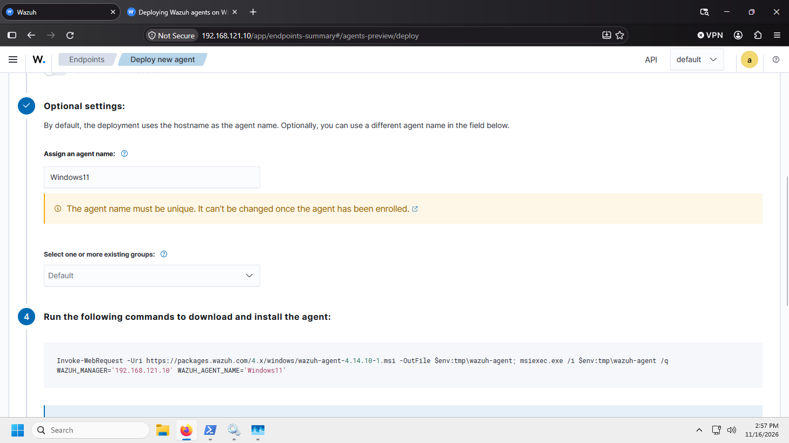
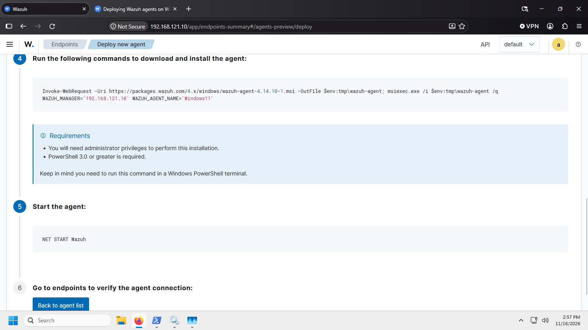
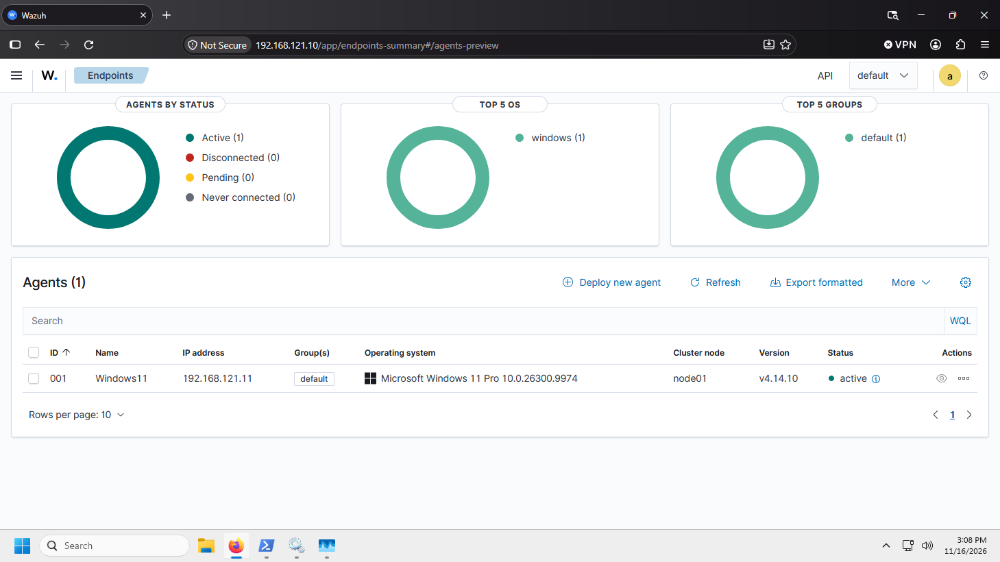
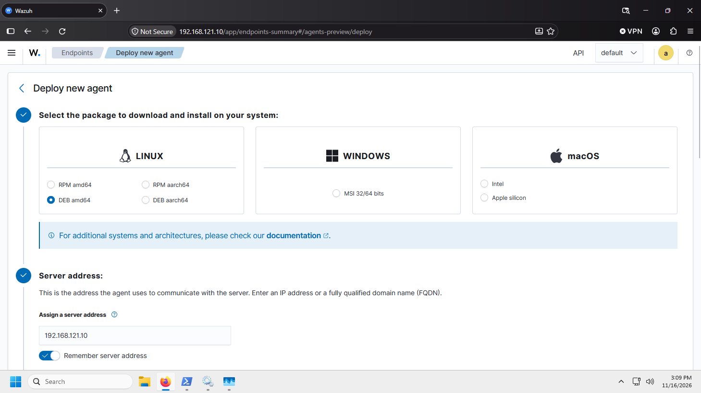
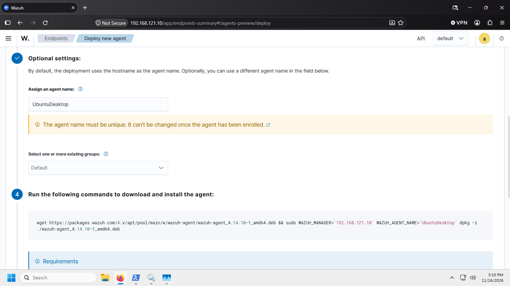
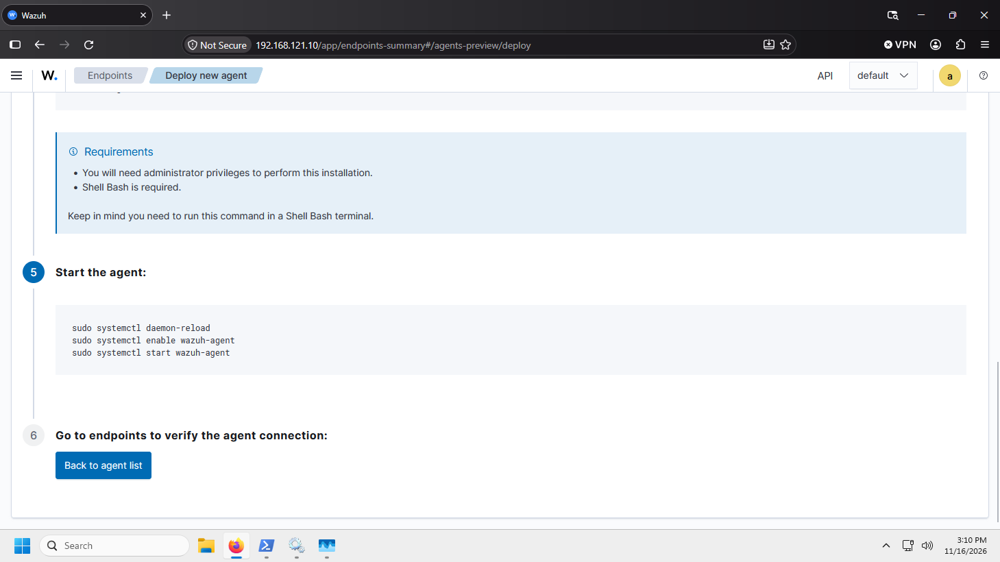
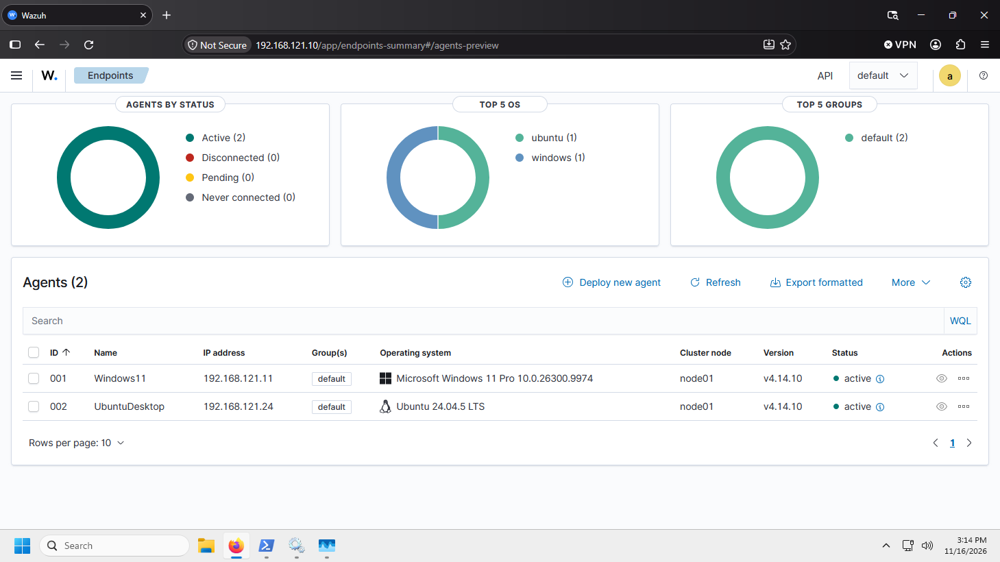

# Wazuh Agents Deployment
### 2026-11-16 | Jeffar

1. On the Wazuh Overview, click “Deploy new agent”.

2. Follow the Wazuh instructions to deploy Windows11.

3. Check the agent list to verify the agent connection.

4. Follow the Wazuh instructions to deploy UbuntuDesktop.

5. Check the agent list to verify the agent connection.

## Conclusion

**Wazuh** agents were deployed on Windows11 and
UbuntuDesktop through the dashboard’s deploy wizard. Both agents
connected to the Wazuh Manager and show as active in the Agents list.
