# Wazuh Logs Integration
### 2026-11-17 | Jeffar

1. Open the Wazuh Agent log collection configuration file.

```bash
student@ubuntudesktop:~\$ sudo nano /var/ossec/etc/ossec.conf
```

2. Inside the existing \<ossec_config\> element, add:

```bash
\<localfile\>

\<log_format\>json\</log_format\>

\<location\>/var/log/suricata/eve.json\</location\>

\</localfile\>
```

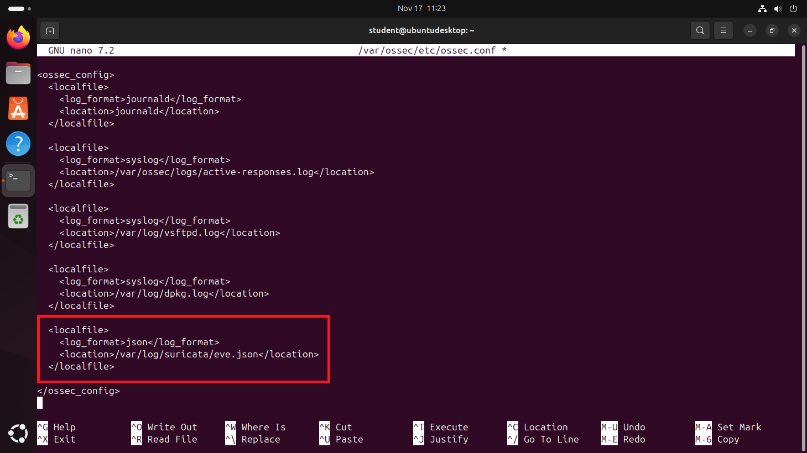

This tells Wazuh's Logcollector to monitor Suricata's eve.json file.
Wazuh has a built-in JSON decoder for extracting event fields.

3. Apply the configuration by restarting the Wazuh Agent.

```bash
student@ubuntudesktop:~\$ sudo systemctl restart wazuh-agent
```

4. Update Suricata.

```bash
student@ubuntudesktop:~\$ sudo suricata-update
```

5. Restart Suricata.

```bash
student@ubuntudesktop:~\$ sudo systemctl restart suricata
```

6. On the first terminal, check whether Suricata is generating alert
events.

```bash
student@ubuntudesktop:~\$ sudo tail -n 0 -F /var/log/suricata/eve.json
\| jq -c 'select(.event_type == "alert")'
```

leave this running.

7. On a second terminal, send ICMP requests to WazuhManager.

```bash
student@ubuntudesktop:~\$ curl -v <http://testmynids.org/uid/index.html>
```

After running this command, terminal 1 should have an output detecting
ICMP traffic:

```bash
{"timestamp":"2026-11-17T11:44:11.985391-0500","flow_id":854524944434235,"in_iface":"ens33","event_type":"alert","src_ip":"192.168.121.24","src_port":0,"dest_ip":"192.168.121.10","dest_port":0,"proto":"ICMP","icmp_type":8,"icmp_code":0,"pkt_src":"wire/pcap","alert":{"action":"allowed","gid":1,"signature_id":1000001,"rev":1,"signature":"ICMP
Ping
Detected","category":"","severity":3},"direction":"to_server","flow":{"pkts_toserver":1,"pkts_toclient":0,"bytes_toserver":98,"bytes_toclient":0,"start":"2026-11-17T11:44:11.985391-0500","src_ip":"192.168.121.24","dest_ip":"192.168.121.10"}}

{"timestamp":"2026-11-17T11:44:11.985909-0500","flow_id":854524944434235,"in_iface":"ens33","event_type":"alert","src_ip":"192.168.121.10","src_port":0,"dest_ip":"192.168.121.24","dest_port":0,"proto":"ICMP","icmp_type":0,"icmp_code":0,"pkt_src":"wire/pcap","alert":{"action":"allowed","gid":1,"signature_id":1000001,"rev":1,"signature":"ICMP
Ping
Detected","category":"","severity":3},"direction":"to_client","flow":{"pkts_toserver":1,"pkts_toclient":1,"bytes_toserver":98,"bytes_toclient":98,"start":"2026-11-17T11:44:11.985391-0500","src_ip":"192.168.121.24","dest_ip":"192.168.121.10"}}
```

8. On the Wazuh dashboard, go to Threat Intelligence -\> Threat
Hunting.

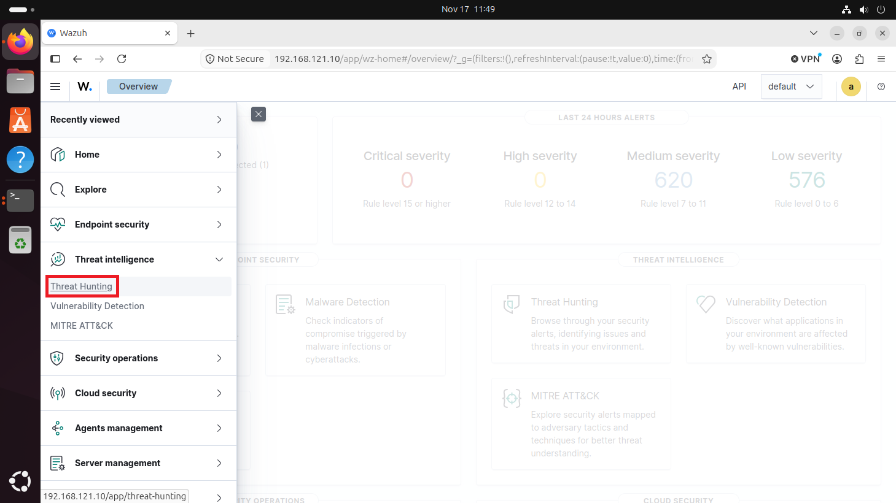

9. On Threat Hunting, go to Events.

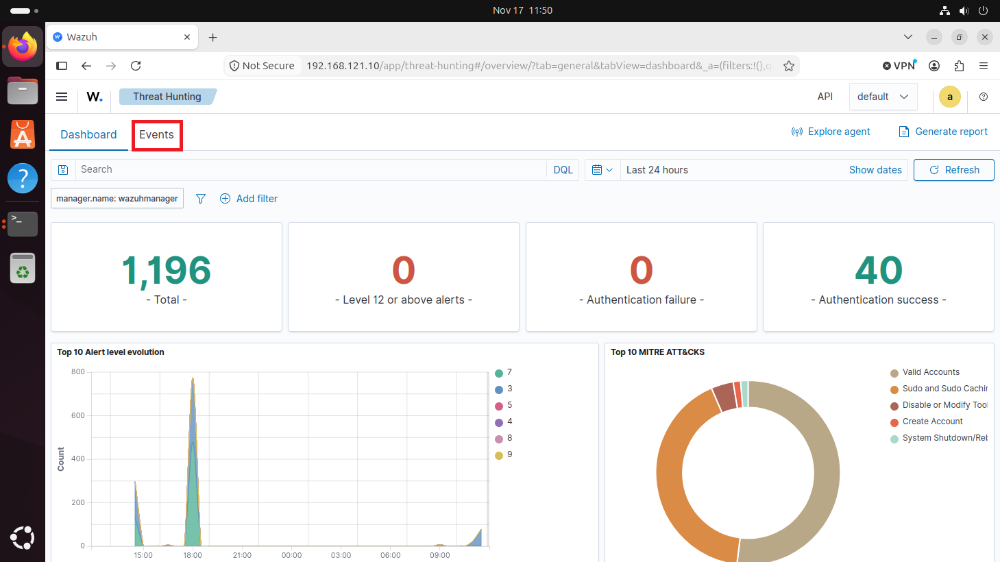

10. Add filter **rule.groups:suricata**.

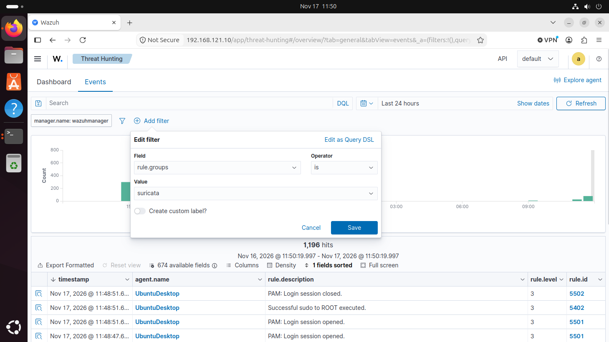

11. Verify Suricata alerts appear in the Wazuh dashboard.

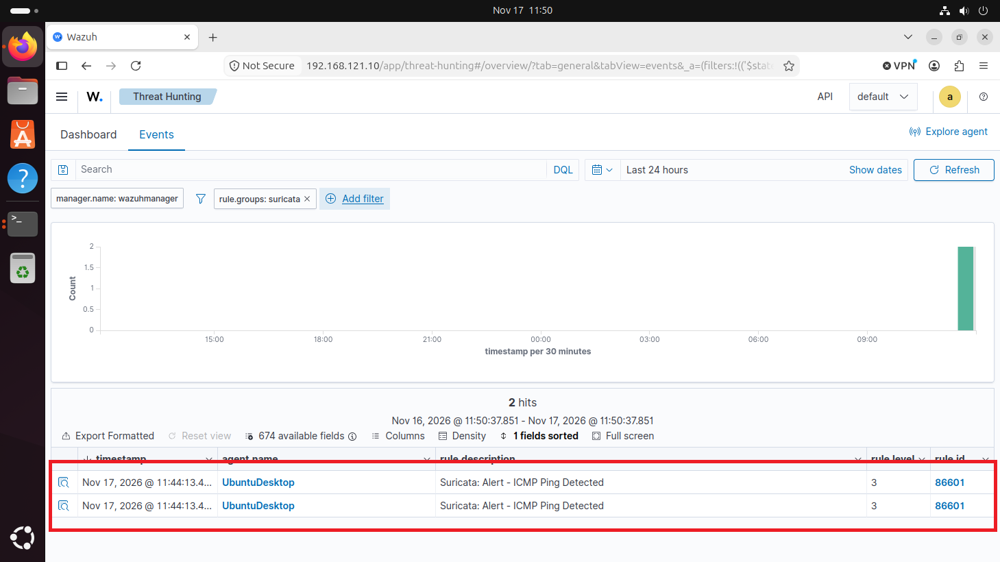

Suricata -\> Wazuh log integration is now complete.

12. On Windows11, run powershell as administrator and open the Wazuh
agent configuration.

```powershell
PS C:\WINDOWS\system32\> notepad "C:\Program Files
(x86)\ossec-agent\ossec.conf"
```

13. Inside the existing \<ossec_config\> tags, add:

```powershell
\<localfile\>

\<location\>Microsoft-Windows-Sysmon/Operational\</location\>

\<log_format\>eventchannel\</log_format\>

\</localfile\>
```

This tells the agent which Windows Event Log to monitor and collect.

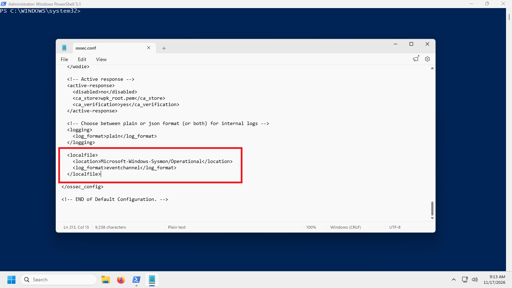

14. Restart the Wazuh agent.

```powershell
PS C:\WINDOWS\system32\> Restart-Service -Name WazuhSvc
```

15. Generate a Sysmon process-creation event.

```powershell
PS C:\WINDOWS\system32\> Start-Process notepad.exe
```

16. Open Event Viewer, navigate to Applications and Services Logs -\>
Microsoft -\> Windows -\> Sysmon -\> Operational, and browse the recent
event of Event ID 1 notepad.exe.

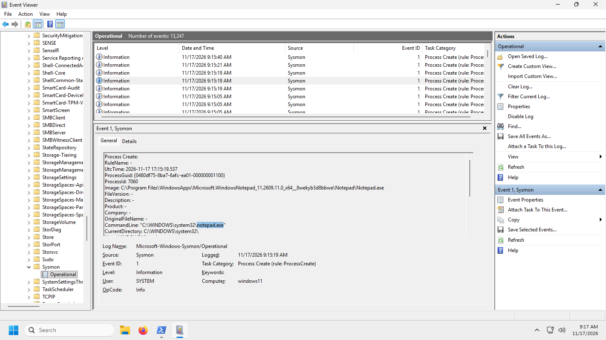

This confirms that Windows11 Sysmon recorded it.

17. On WazuhManager, open the local rules file.

```bash
student@wazuhmanager:~\$ sudo nano /var/ossec/etc/rules/local_rules.xml
```

18. Create a custom Wazuh rule inside the existing \<group\> block that
detects Sysmon process-creation events involving notepad.exe that
generates a Level 5 alert.

```bash
\<rule id="100100" level="5"\>

\<if_sid\>61603\</if_sid\>

\<field name="win.eventdata.image"\>\\\notepad\\.exe\$\</field\>

\<description\>Sysmon: Notepad process creation\</description\>

\<group\>sysmon_event1,notepad,\</group\>

\</rule\>
```

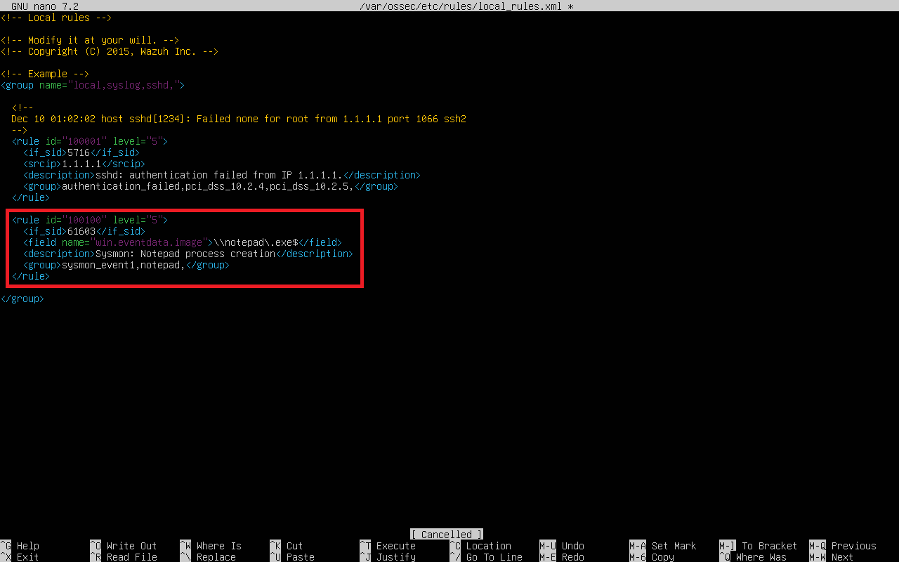

19. Restart wazuh-manager.

```bash
sudo systemctl restart wazuh-manager
```

20. Generate another event on Windows11.

```powershell
PS C:\WINDOWS\system32\> Start-Process notepad.exe
```

21. On the Wazuh dashboard, go to Threat Intelligence -\> Threat
Hunting.

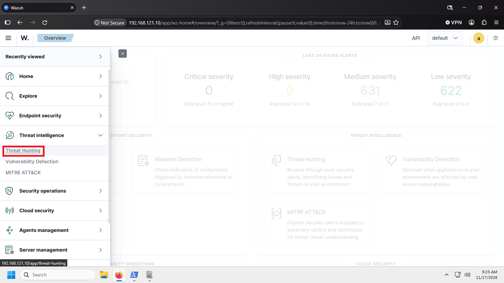

22. On Threat Hunting, go to Events.

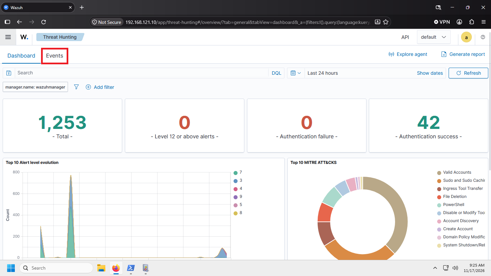

23. Add filter **rule.id:100100**.

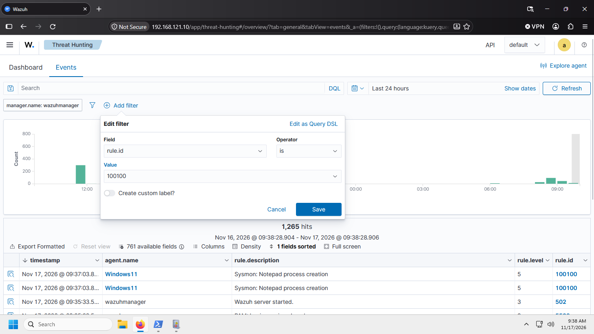

24. Verify Sysmon alerts appear in the Wazuh dashboard.

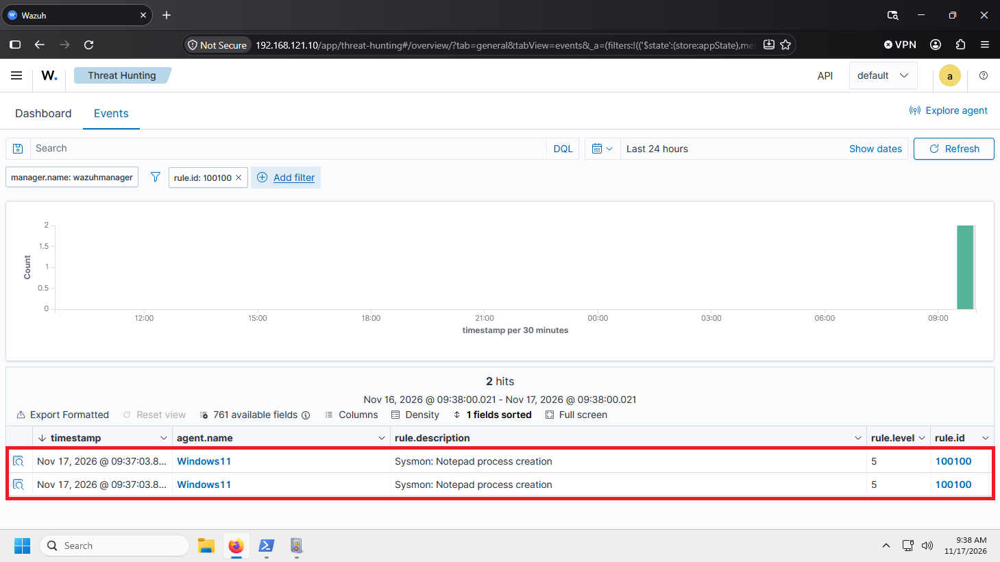

Sysmon -\> Wazuh log integration is now complete.

## Conclusion

Integrating **Suricata** and **Sysmon** with Wazuh enabled
centralized security monitoring and improved visibility into network and
endpoint threats.
