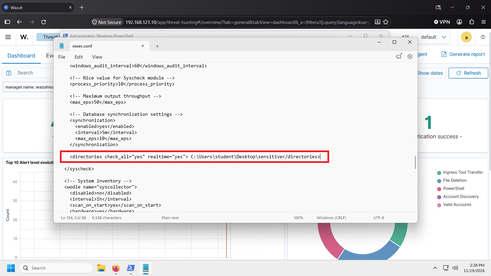
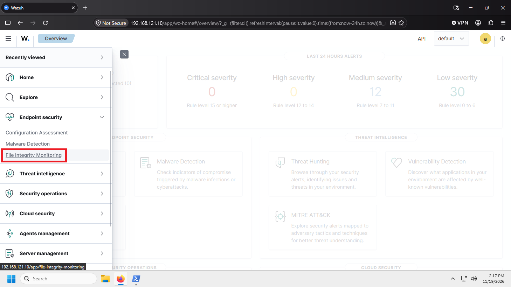
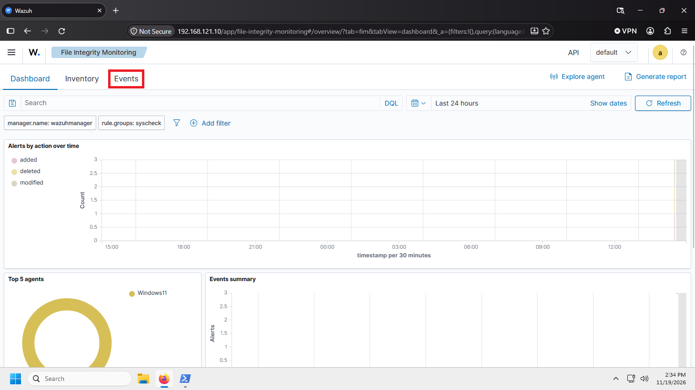
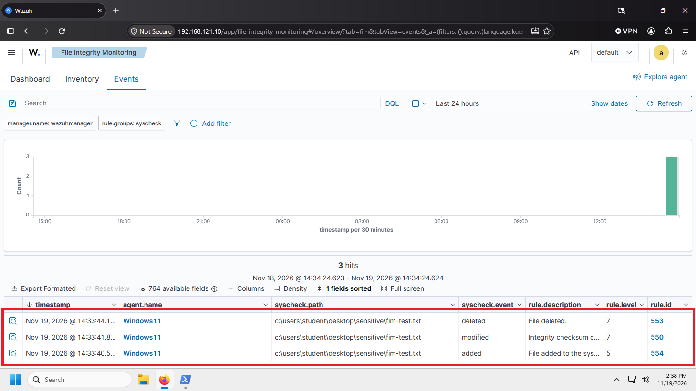
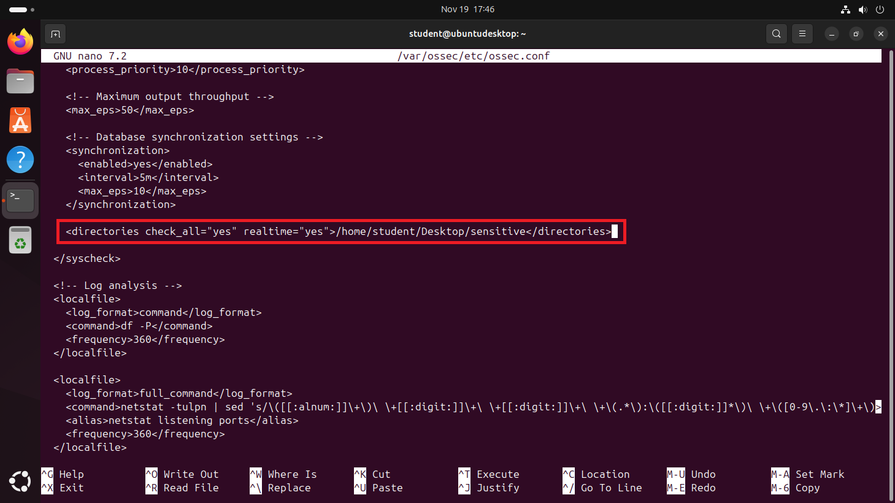
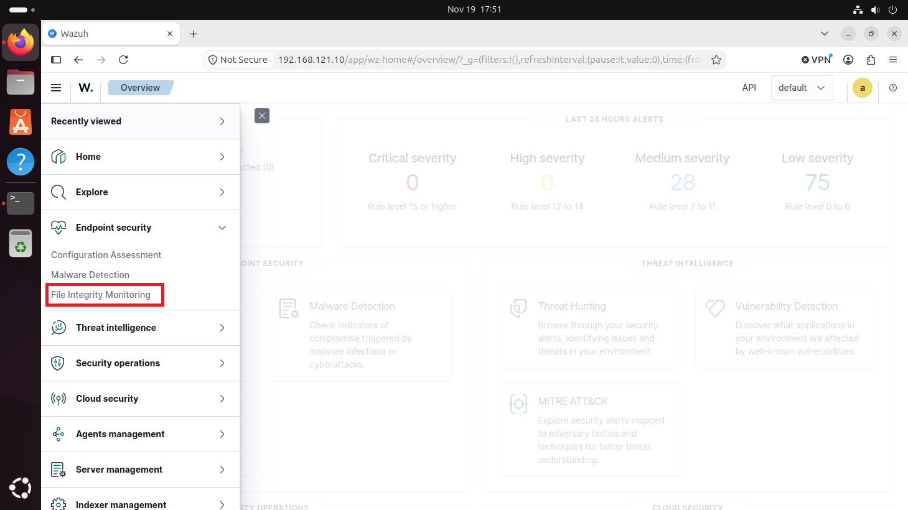
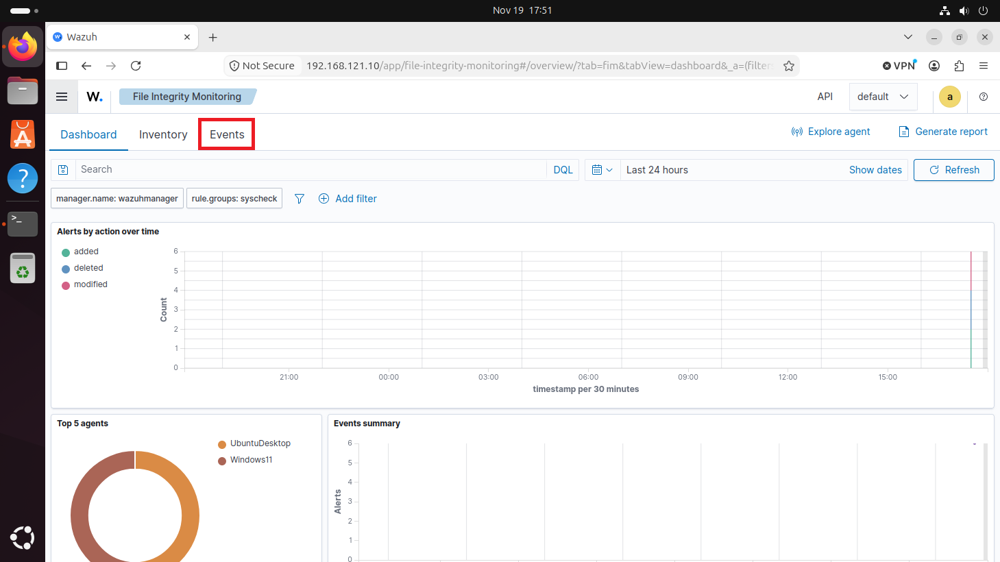
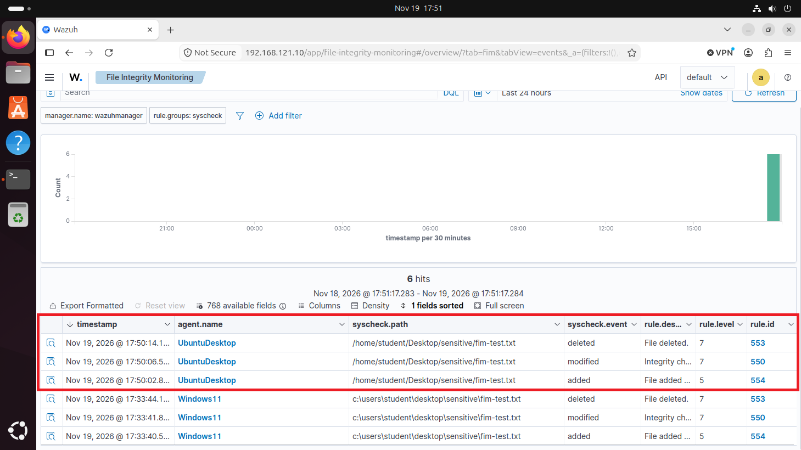

# Configuring File Integrity Monitoring
### 2026-11-19 | Jeffar

1. Run powershell as admin. Create a folder named `sensitive` on the
Windows11 desktop.

```powershell
PS C:\WINDOWS\system32\> mkdir "\$env:USERPROFILE\Desktop\sensitive"
```
2. Open the Wazuh agent configuration.

```powershell
PS C:\WINDOWS\system32\> notepad "C:\Program Files
(x86)\ossec-agent\ossec.conf"
```

3. Get the exact directory path of `sensitive`.

```powershell
PS C:\WINDOWS\system32\> "\$env:USERPROFILE\Desktop\sensitive"
```

output:

```powershell
C:\Users\student\Desktop\sensitive
```

4. Find the existing \<syscheck\> section and add this line inside it.

```
\<directories check_all="yes"
realtime="yes"\>C:\Users\student\Desktop\sensitive\</directories\>
```



This enables continuous file monitoring with the recently created
folder.

5. Save the file, then restart the agent.

```powershell
PS C:\WINDOWS\system32\> Restart-Service -Name WazuhSvc
```

6. Wait until real-time monitoring starts.

```powershell
PS C:\WINDOWS\system32\> Get-Content "C:\Program Files
(x86)\ossec-agent\ossec.log" -Tail 50 \|

\>\> Select-String "6012\|syscheck\|ERROR"
```

output:

```powershell
2026/11/19 14:30:52 wazuh-agent: INFO: (6012): Real-time file integrity
monitoring started.
```

7. Create a test file inside `sensitive`.

```powershell

PS C:\WINDOWS\system32\> "Hello World!" \| Out-File
"\$env:USERPROFILE\Desktop\sensitive\fim-test.txt"

```

8. Modify the test file.

```powershell
PS C:\WINDOWS\system32\> "Hi World!" \| Out-File
"\$env:USERPROFILE\Desktop\sensitive\fim-test.txt"
```

9. Delete the test file.

```powershell
PS C:\WINDOWS\system32\> Remove-Item
"\$env:USERPROFILE\Desktop\sensitive\fim-test.txt"
```

10. On Wazuh dashboard, go to File Integrity Monitoring for the
creation, modification, and deletion events.







Windows11 FIM is now working.

11. Open a terminal. Create a folder named `sensitive` on the
UbuntuDesktop desktop.

```bash
student@ubuntudesktop:~\$ mkdir -p ~/Desktop/sensitive
```

12. Print its full path.

```bash
student@ubuntudesktop:~\$ realpath ~/Desktop/sensitive
```

output:

```bash
/home/student/Desktop/sensitive
```

13. Open the Wazuh agent configuration.

```bash
student@ubuntudesktop:~\$ sudo nano /var/ossec/etc/ossec.conf
```

14. Find the existing \<syscheck\> section and add this line inside it.

```
\<directories check_all="yes"
realtime="yes"\>/home/student/Desktop/sensitive\</directories\>
```



This enables continuous file monitoring with the recently created
folder.

15. Save and exit, then restart the Wazuh agent.

```bash
student@ubuntudesktop:~\$ sudo systemctl restart wazuh-agent
```

16. Wait until real-time monitoring starts.

```bash
student@ubuntudesktop:~\$ sudo grep -E '6012\|ERROR'
/var/ossec/logs/ossec.log \| tail -n 20
```

output:

```
2026/11/19 17:47:24 wazuh-syscheckd: INFO: (6012): Real-time file
integrity monitoring started.
```

17. Create a test file inside `sensitive`.

```bash
student@ubuntudesktop:~\$ echo "Hello World!" \>
~/Desktop/sensitive/fim-test.txt
```

18. Modify the test file.

```bash
student@ubuntudesktop:~\$ echo "Hi World!" \>
~/Desktop/sensitive/fim-test.txt
```

19. Delete the test file.

```bash
student@ubuntudesktop:~\$ rm ~/Desktop/sensitive/fim-test.txt
```

20. On Wazuh dashboard, go to File Integrity Monitoring for the
creation, modification, and deletion events.







UbuntuDesktop FIM is now working.

## Conclusion

**File Integrity Monitoring** was successfully configured on
Windows 11 and Ubuntu Desktop to detect file creation, modification, and
deletion.
