# Step #1: Install and Configure Suricata

**Install Suricata on the Ubuntu Desktop VM.**

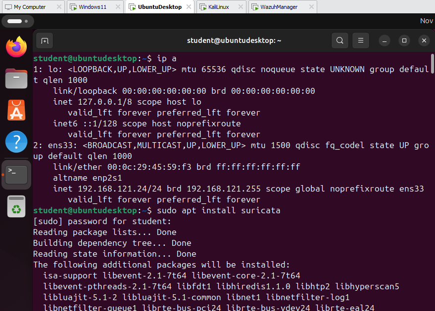

**Identify the correct network interface and configure it in
/etc/suricata/suricata.yaml. Set the correct NIC.**

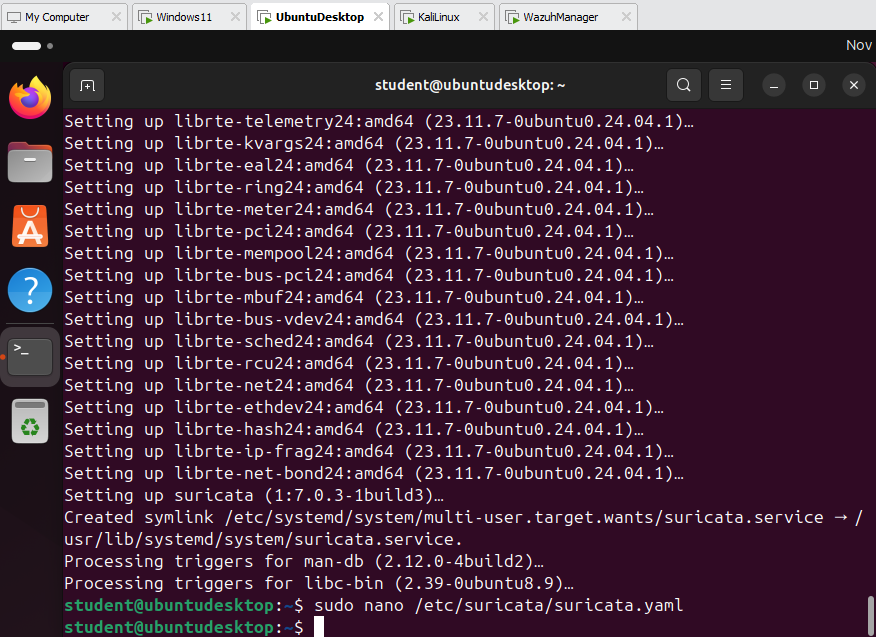

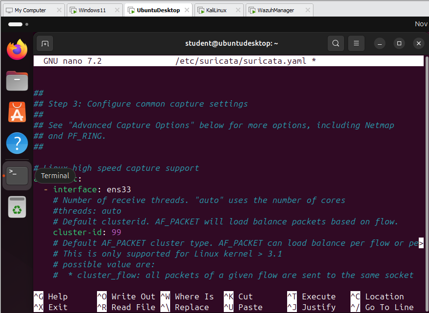

# Step #2: Create Custom Suricata Rules

**Run the command to create a new rule file named myCustom.rules within
the rules directory you set up in the previous step.**

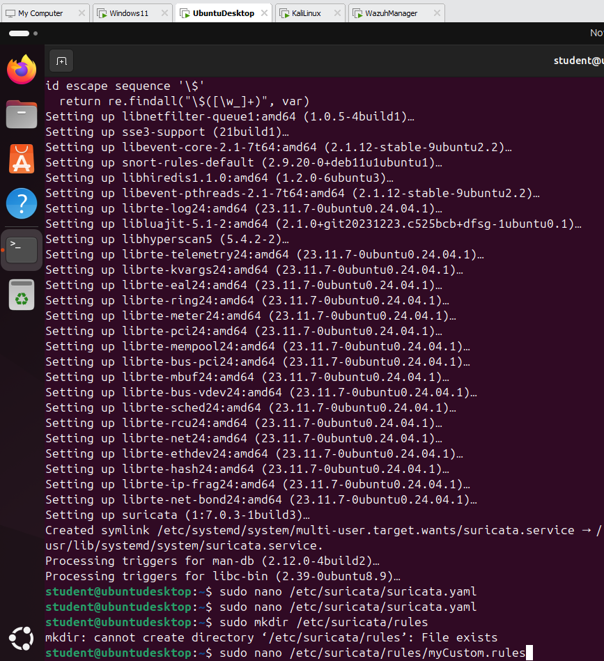

**Add the following rule to detect ICMP Echo request. This also helps to
confirm Suricata is working. Also save changes and exit nano editor.**

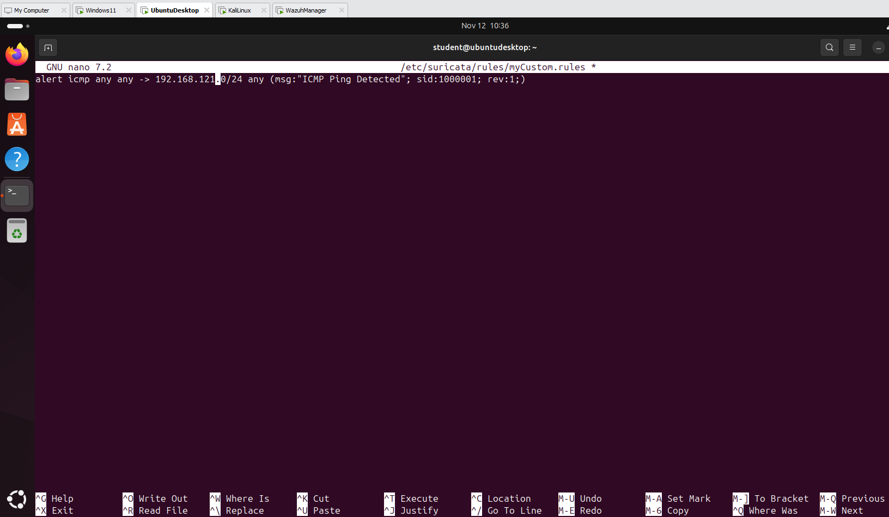

**Modify the rule-files section in /etc/suricata/suricata.yaml file.**

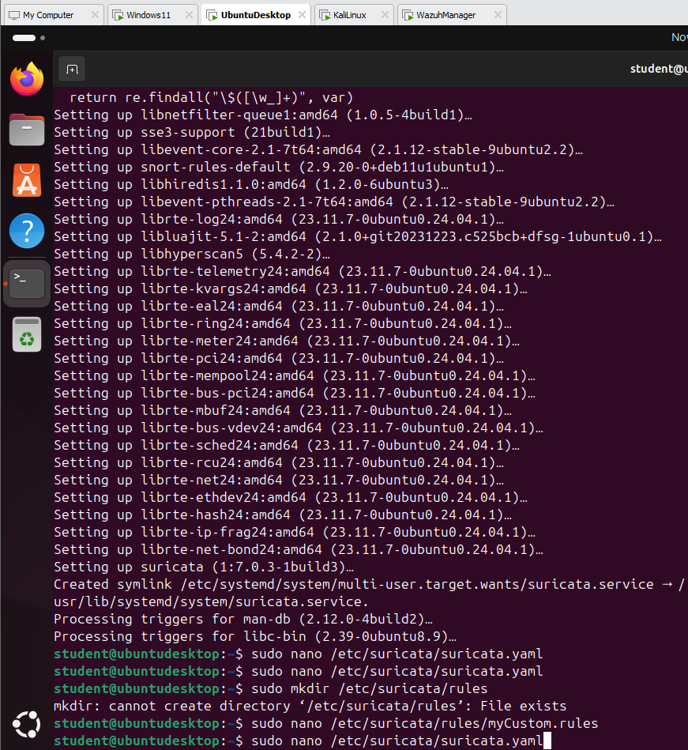

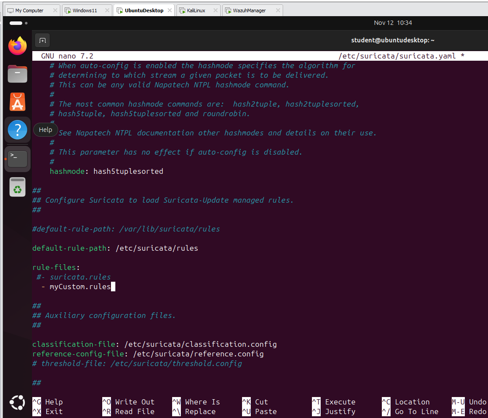

**Run the command to validate Suricata configuration**

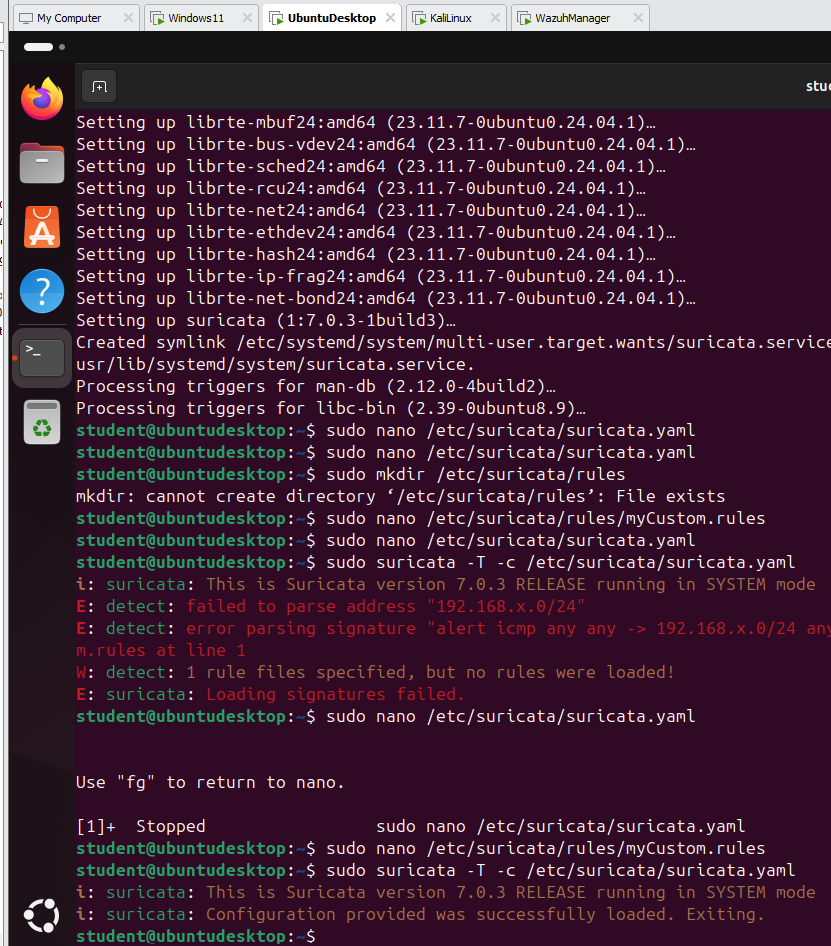

**Enable Suricata to Start automatically and verify that Suricata is
running**

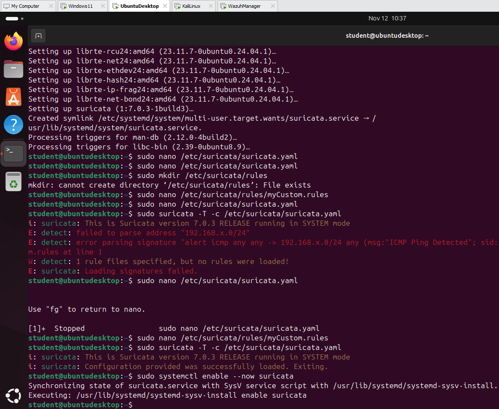

# Step #3: Monitor Alerts

**From Kali, ping Ubuntu**

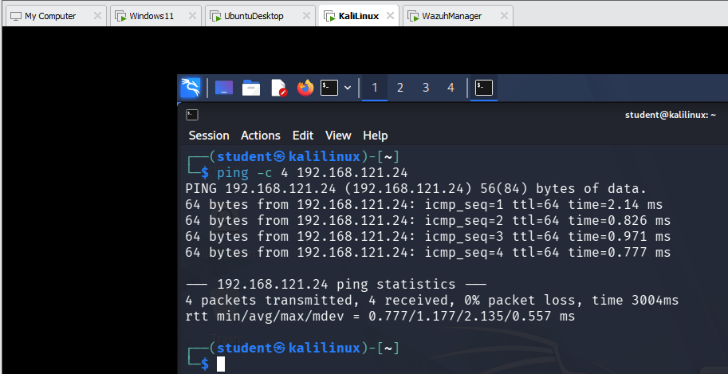

**Check the Suricata Logs**

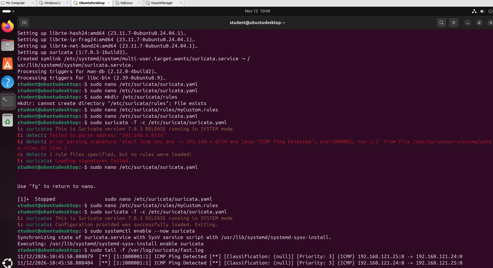

# Step #4: Write 3 Custom Suricata Rules

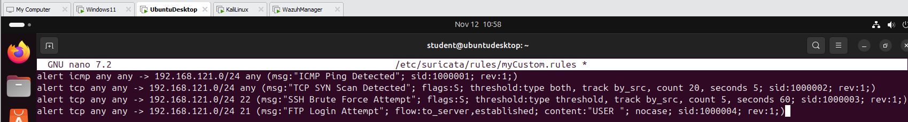

# Step #5: Simulate and Validate Alerts Locally

**From Kali Linux, generate test traffic that matches your chosen
rules.**

**TCP SYN Scan:**

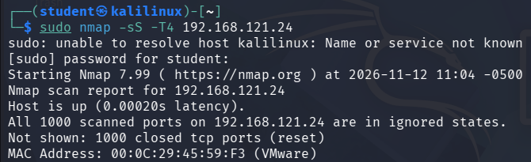

**SSH Brute Force:**

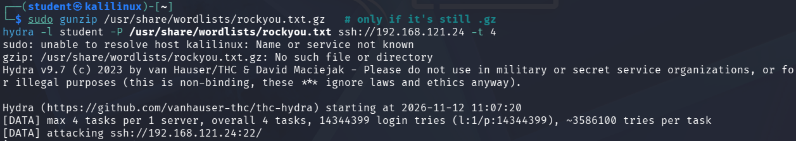

**FTP Login:**

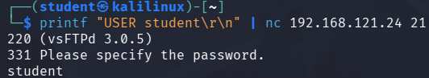

**Observe and confirm alerts**

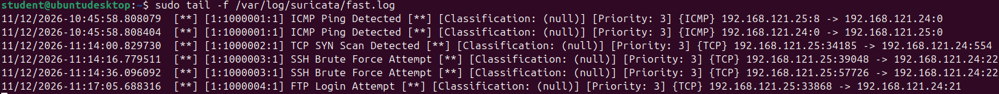

## Documentation Table

<table>
<colgroup>
<col style="width: 16%" />
<col style="width: 16%" />
<col style="width: 16%" />
<col style="width: 16%" />
<col style="width: 16%" />
<col style="width: 16%" />
</colgroup>
<tbody>
<tr>
<td>
<strong>#</strong>
</td>
<td>
<strong>Rule Goal</strong>
</td>
<td>
<strong>SID</strong>
</td>
<td>
<strong>Test Command</strong>
</td>
<td>
<strong>Detected</strong>
</td>
<td>
<strong>Short Analysis</strong>
</td>
</tr>
<tr>
<td>
1
</td>
<td>
ICMP
</td>
<td>
1000001
</td>
<td>
ping -c 4 192.168.121.24
</td>
<td>
Yes
</td>
<td>
Suricata was able to match it on the ICMP protocol to the
subnet.
</td>
</tr>
<tr>
<td>
2
</td>
<td>
TCP SYN
</td>
<td>
1000002
</td>
<td>
sudo nmap -sS -T4 192.168.121.24
</td>
<td>
Yes
</td>
<td>
The threshold correctly flagged the SYN packets from the Nmap
scan as port-scanning behaviour.
</td>
</tr>
<tr>
<td>
3
</td>
<td>
SSH
</td>
<td>
1000003
</td>
<td>
sudo gunzip /usr/share/wordlists/rockyou.txt.gz # only if it's
still .gz

hydra -l student -P /usr/share/wordlists/rockyou.txt
ssh://192.168.121.24 -t 4
</td>
<td>
Yes
</td>
<td>
Hydra exceeded the 5-attempts-in-60-seconds threshold.
</td>
</tr>
<tr>
<td>
4
</td>
<td>
FTP
</td>
<td>
1000004
</td>
<td>
printf "USER student\r\n" | nc 192.168.121.24 21
</td>
<td>
Yes
</td>
<td>
The alert fired on the “USER” content match because vsftpd was
active and listening on port 21.
</td>
</tr>
</tbody>
</table>
