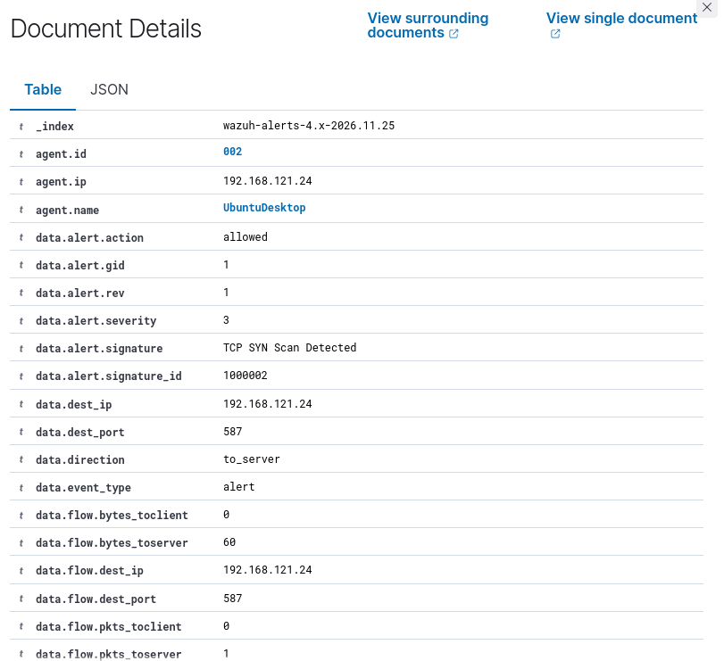
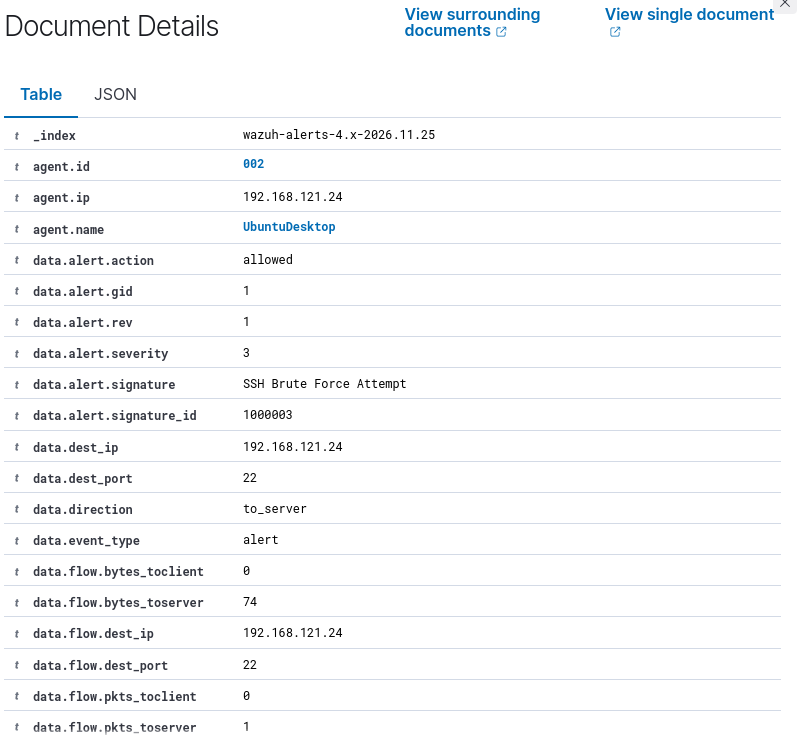
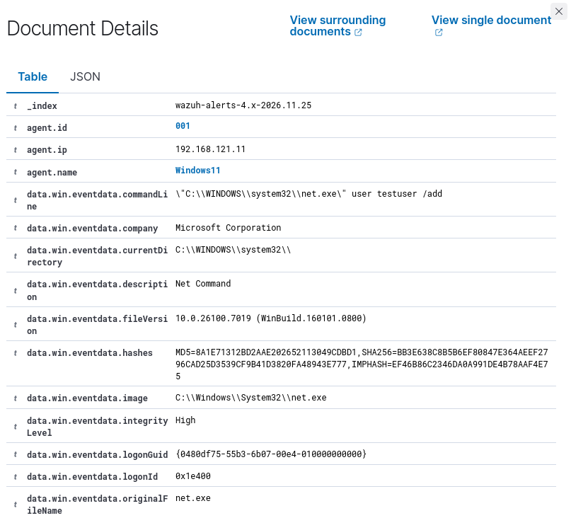
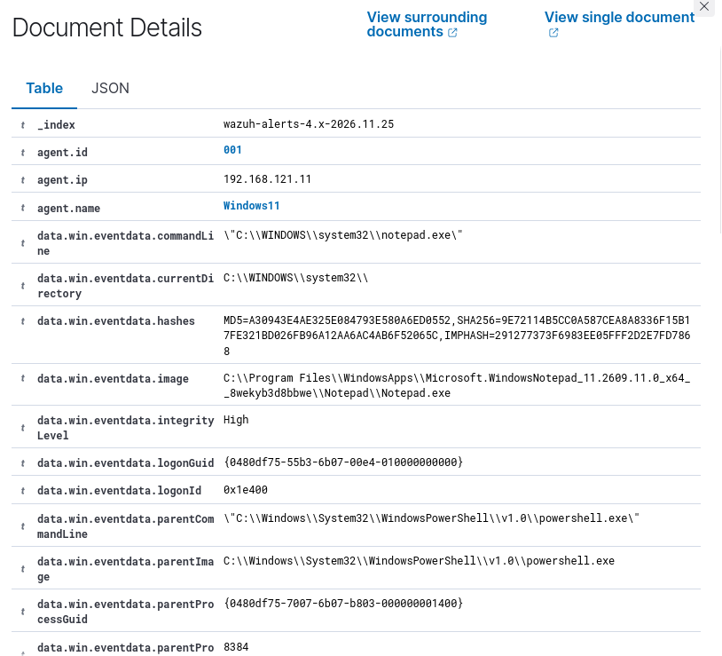
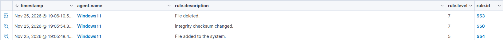
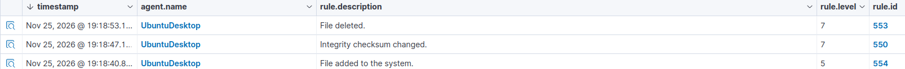

# Suricata Tests

**Test \#1 title and target detection rule:** TCP SYN Scan Detection - Custom Suricata rule SID 1000002 “TCP SYN Scan Detection”

**Command:**

sudo nmap -S -T4 192.168.121.24

**Evidence:**

**Result and Analysis:** The rule in Suricata that we made matched on flags:S with a threshold of 20 SYN packets in 5 seconds that came from a single source, the SYN scan from Nmap made this burst at Ubuntu, which fired the alert.

**MITRE ATT&CK mapping:** Tactic: Discovery (TA00007), Technique: Network Service Discovery (T1046)

**Test \#2 title and target detection rule:** SSH Brute Force: customer Suricata rule SID 1000003 “SSH Brute Force Attempt” and Wazuh host rule \#5763

**Command:**

hydra -l student -P /usr/share/wordlists/rockyou.txt ssh://192.168.121.24 -t 4

**Evidence:**

**Result and Analysis:** The Suricata rule matched the SYN packets that were exceeding 5 attempts. And Wazuh rule \#5763 matched multiple failed ssh authentication log entries to the same source IP address at the same time.

**MITRE ATT&CK mapping:** Tactic: Credential Access (TA00006), Technique: Brute Force (T1110)

**Sysmon Tests**

**Test \#1 title and target detection rule:** Account Creation Attempt: Wazuh rule 92033 “Discovery activity spawned via powershell execution”

**Command:**

net user testuser /add

**Evidence:**

**Result and Analysis:** Event ID \#1 of Sysmon captured net.exe being created through “net user testuser /add”, which was launched on Powershell (Admin) through “student”. Wazuh connected this relationship of Powershell launching net.exe with account-management arguments to a discovery alert.

**MITRE ATT&CK mapping:** Tactics: Discovery (T1087) and Execution (T1059.001), Technique: Create Account: Local Account (T1136.001)

**Test \#2 title and target detection rule:** Process Creation: fired custom Wazuh rule \#100100 “Sysmon: Notepad process creation”

**Command:**

notepad.exe

**Evidence:**

**Result and Analysis:** Event ID \#1 captured notepad.exe being launched through a Powershell (Admin) window by “student”. This fired a custom rule with a purpose that flags anytime Notepad gets launched.

**MITRE ATT&CK mapping:** None

**FIM Tests**

**Test \#1 title and target detection rule:** File Integrity Monitoring: Add/Modify/Delete sequence; rules 554 (file being added), 550 (checksum getting changed), 553 (file being deleted)

**Command:**

New-Item C:\Users\student\Desktop\sensitive\test.txt -ItemType File

Set-Content C:\Users\student\Desktop\sensitive\test.txt “modified content here”

Remove-Item C:\Users\student\Desktop\sensitive\test.txt

**Evidence:**

**Result and Analysis:** Wazuh’s FIM accurately detected every stage of a file’s lifecycle. Such as it being created (553), the content in the file getting modified (554), and finally, the file getting deleted. Every single stage occurred around 5-7 seconds after each other.

**MITRE ATT&CK mapping:** Tactic: Execution (TA0002), Technique: Command and Scripting Interpreter: Powershell (T1059.001)

**Test \#2 title and target detection rule:** File Integrity Monitoring: Add/Modify/Delete sequence; rules 554 (file being added), 550 (checksum getting changed), 553 (file being deleted)

**Command:**

touch /home/student/Desktop/sensitive/test.txt

echo /home/student/Desktop/sensitive/test.txt

rm /home/student/Desktop/sensitive/test.txt

**Evidence:**

**Result and Analysis:** Wazuh’s FIM called syscheck flagged the entire file creation process on Ubuntu. It started with rule 554 (File Creation), then moved on to rule 550 (modification through checksum change) and finally to 553 (file deletion).

MITRE ATT&CK mapping: Tactics: Impact (TA0040), Defense Evasion (TA0005), **Techniques:** Data Manipulation (T1565) for file modification and Indicator Removal: File Deletion (T1070.004) for file deletion.
