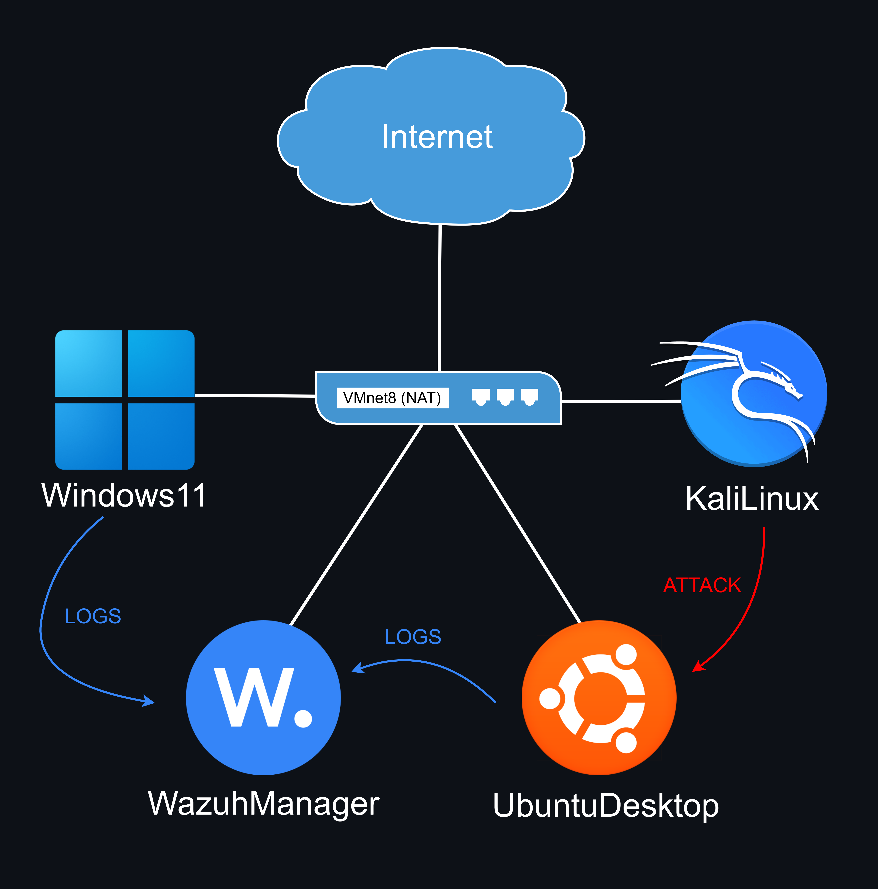

---

# MINI SOC USING WAZUH

A small security operations lab: a Windows 11 endpoint monitored with Sysmon, an Ubuntu endpoint monitored with Suricata, and a Kali attacker, with Wazuh as the central SIEM. All four VMs run on a VMware NAT network.

---

### Environment

| VM            | Role                                     | OS             | Address          | Assignment |
|---------------|------------------------------------------|----------------|------------------|------------|
| WazuhManager  | SIEM (Wazuh Manager, dashboard)          | Ubuntu Server  | 192.168.121.10   | Static     |
| Windows11     | Endpoint (Sysmon, Wazuh agent)           | Windows 11     | 192.168.121.11   | Static     |
| UbuntuDesktop | Endpoint (Suricata, Wazuh agent)         | Ubuntu Desktop | 192.168.121.24   | Static     |
| KaliLinux     | Attacker                                 | Kali Linux     | 192.168.121.25   | Static     |

Network: VMware NAT (VMnet8), `192.168.121.0/24`, gateway `192.168.121.2`.

---

### What was built

- Four VMs on a VMware NAT network with static IPs and Internet access.
- Sysmon on Windows11 using the SwiftOnSecurity configuration, running as a service.
- Suricata on UbuntuDesktop with four custom rules: ICMP ping, TCP SYN scan, SSH brute force and FTP login attempt.
- Wazuh Manager and dashboard on WazuhManager, with Wazuh agents on Windows11 and UbuntuDesktop.
- Suricata alerts and Sysmon events forwarded to Wazuh, plus a custom rule that detects `notepad.exe` process creation.
- Real-time file integrity monitoring on a `sensitive` folder on both endpoints.
- Six attack and test scenarios (Nmap SYN scan, Hydra SSH brute force, account creation, `notepad.exe` and file changes on both endpoints), each traced to a Wazuh alert.
- A Wazuh active response that blocks the attacker's IP with `firewall-drop` when SSH brute force rule `5763` fires.

---

## Lab parts

### Part 1: Environment setup
[`01-Host-Setup.md`](Jeffar%20Documentation/01-Host-Setup.md), [`02-Network-and-IP-Configuration.md`](Jeffar%20Documentation/02-Network-and-IP-Configuration.md)

VMnet8 was set to `192.168.121.0/24` on the host. The four VMs were given static addresses on that network, and Windows11 was set to answer inbound ping. Connectivity was tested from Windows11 to every other VM and from each VM to the Internet.

**Evidence:** Pings from Windows11 to `192.168.121.10`, `192.168.121.24`, `192.168.121.25` and `8.8.8.8`, and pings to `8.8.8.8` from the other three VMs.

**Verified:** All pings succeed and every VM reaches the Internet.

### Part 2: Sysmon on Windows11
[`03-Sysmon.md`](Jeffar%20Documentation/03-Sysmon.md)

Sysmon was installed from Sysinternals with the SwiftOnSecurity configuration. From an elevated PowerShell session, `whoami`, `net user testuser /add` and `notepad.exe` were run and traced in the Sysmon Operational log.

**Evidence:** Event ID 1 (Process Create) for `whoami.exe`, `net.exe` with its child `net1.exe`, and `notepad.exe`, each with image, command line and user.

**Verified:** Events appear in Event Viewer under Sysmon, Operational.

### Part 3: Suricata on UbuntuDesktop
[`04-Suricata.md`](Matthew%20Documentation/04-Suricata.md)

Suricata was installed on UbuntuDesktop and pointed at a custom rules file, `myCustom.rules`. The file holds four rules (SID 1000001 to 1000004): ICMP ping, TCP SYN scan, SSH brute force and FTP login attempt. Each was triggered from KaliLinux.

**Evidence:** One alert per rule in `/var/log/suricata/fast.log`, from `192.168.121.25` to `192.168.121.24`.

**Verified:** `suricata -T` loads the configuration, and every rule fires on its test.

### Part 4: Wazuh integration
[`05-Wazuh-Installation.md`](Jeffar%20Documentation/05-Wazuh-Installation.md), [`06-Wazuh-Agents-Deployment.md`](Jeffar%20Documentation/06-Wazuh-Agents-Deployment.md), [`07-Wazuh-Logs-Integration.md`](Jeffar%20Documentation/07-Wazuh-Logs-Integration.md)

Wazuh was installed on WazuhManager, and agents were deployed on Windows11 and UbuntuDesktop from the dashboard. The Ubuntu agent collects Suricata's `eve.json`, and the Windows agent collects the `Microsoft-Windows-Sysmon/Operational` channel. A custom rule (ID `100100`) raises a level 5 alert when Sysmon records `notepad.exe` being created.

**Evidence:** The Agents list with both agents active, Suricata alerts under `rule.groups:suricata`, and rule `100100` alerts under `rule.id:100100`.

**Verified:** Suricata alerts and Sysmon events appear in the Wazuh dashboard.

### Part 5: File integrity monitoring
[`08-Configuring-FIM.md`](Jeffar%20Documentation/08-Configuring-FIM.md)

Real-time monitoring was enabled on `C:\Users\student\Desktop\sensitive` (Windows11) and `/home/student/Desktop/sensitive` (UbuntuDesktop). On each machine a file was created, modified and deleted.

**Evidence:** The agent log line confirming real-time monitoring started (rule `6012`), and the FIM events in the dashboard.

**Verified:** Creation, modification and deletion events appear for both endpoints.

### Part 6: Attack simulation and validation
[`09-Attack-Simulation-and-Validation.md`](Matthew%20Documentation/09-Attack-Simulation-and-Validation.md)

Six tests were run and traced to Wazuh alerts: a TCP SYN scan (Nmap) and an SSH brute force (Hydra) from KaliLinux against UbuntuDesktop, `net user testuser /add` and `notepad.exe` on Windows11, and a file created, modified and deleted in the `sensitive` folder on each endpoint. Each test was mapped to MITRE ATT&CK where it applies.

**Evidence:** The Wazuh alert for each test with the command that triggered it: Suricata alerts (rule `86601`), rules `92033` and `100100` on Windows11, and FIM rules `554`, `550` and `553` on both endpoints.

**Verified:** Every test produces its expected alert in the dashboard.

### Part 7: Wazuh active response
[`10-Wazuh-Active-Response.md`](Matthew%20Documentation/10-Wazuh-Active-Response.md)

An active response was added to `ossec.conf` on WazuhManager: when rule `5763` (SSH brute force) fires, the `firewall-drop` command blocks the source IP on the agent for 180 seconds. The manager was restarted for the change to take effect.

**Evidence:** The rule `5763` alert, the `active-response` block in `ossec.conf`, and the manager running after the restart. On UbuntuDesktop, `iptables` lists a DROP rule for `192.168.121.25` and `active-responses.log` shows `firewall-drop` starting and ending. A ping from KaliLinux to `192.168.121.24` gets no replies.

**Verified:** The attacker IP is blocked, and pings from KaliLinux to UbuntuDesktop show 100% packet loss.

---

### Documentation

Each student documents their own parts: [`Jeffar Documentation/`](Jeffar%20Documentation/), [`Matthew Documentation/`](Matthew%20Documentation/).
